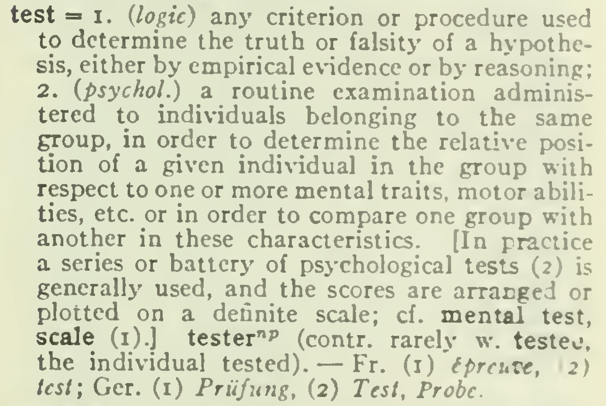
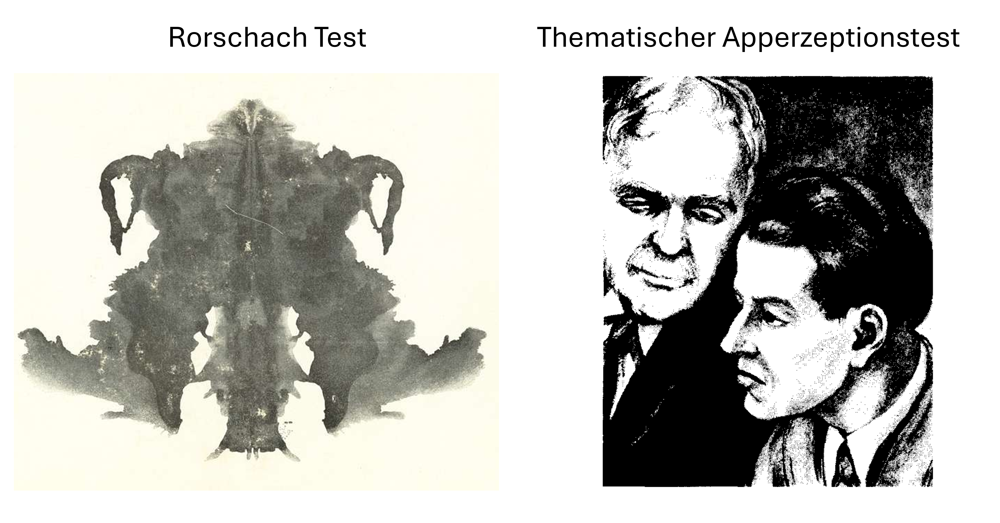

```{r, include = FALSE}
# Unicode-Zeichen beim Rendern unter Windows unverändert ausgeben.
if (.Platform$OS.type == "windows") {
  invisible(Sys.setlocale("LC_CTYPE", ".UTF-8"))
}
```

#  {.plain}
\center
```{r, echo = FALSE, out.width = "20%"}
knitr::include_graphics("1-Abbildungen/gdt-1-otto.png")
```

\vspace{2mm}

\huge
Grundlagen der Testtheorie
\vspace{6mm}

\Large
BSc Psychologie WiSe 2026/27

\large
\vspace{6mm}
Prof. Dr. Dirk Ostwald

#  {.plain}
\vfill
\center
\huge
\textcolor{black}{(1) Psychologische Tests}
\vfill

# 
\vfill
\setstretch{2}
\large
Definitionsversuche

Testarten

Antwortformate

Testgütekriterien

Testtheorien

Testkonstruktion

Selbstkontrollfragen
\vfill

# 
\vfill
\setstretch{2}
\large
**Definitionsversuche**

Testarten

Antwortformate

Testgütekriterien

Testtheorien

Testkonstruktion

Selbstkontrollfragen
\vfill

# Definitionsversuche
\setstretch{1.8}
Test (engl.) \textit{Probe, Prüfung, Kontrolle}

\normalsize
Bedeutungen

* Ein Verfahren zur Untersuchung eines Persönlichkeitsmerkmals
* Der Vorgang der Durchführung einer Untersuchung
* Die Gesamtheit der zur Durchführung einer Untersuchung nötigen Materialien
* Ein statistisches Prüfverfahren (Hypothesentests)
* Kurze, außerplanmäßige "Zettelarbeiten" im Schulunterricht
* u.v.a.m.

\flushright
\footnotesize
@lienert1998

# Definitionsversuche

Test (engl.) \textit{Probe, Prüfung, Kontrolle}

\vfill
```{r, echo = FALSE, out.width = "60%", fig.align="center"}

```

\flushright
\footnotesize
@warren1934 
\vfill

# Definitionsversuche
Definitionsversuche

\footnotesize
Definition eines **Tests** nach @moosbrugger2012 

"Ein *Test* ist ein wissenschaftliches Routineverfahren zu Erfassung eines oder
mehrerer empirisch abgrenzbarer psychologischer Merkmale mit dem Ziel einer 
möglichst genauen quantitativen Aussage über den Grad der individuellen 
Merkmalsausprägung"

Definition eines **psychometrischen Tests** nach @buehner2010

"Ein *psychometrischer Test* ist ein wissenschaftliches Routineverfahren zur Untersuchung
eines oder mehrerer empirisch abgrenzbarer Persönlichkeitsmerkmale (vgl. @lienert1998, S.1).
Das Ziel eines psychometrischen Tests besteht darin, die absolute oder relative Ausprägung
einer Eigenschaft, einer Fähigkeit oder eines Zustands bei einer oder mehreren Personen
zu messen oder eine qualitative Aussage zu treffen, welcher Personenklasse Personen
zugeordnet werden können (vgl. @rost2004). Psychometrische Tests sind nach der
Klassischen oder probabilistischen Testtheorie entwickelt, sind theoretisch fundiert
und genügen genau definierten Gütekriterien (Haupt- und Nebengütekriterien)."

Definition eines **Psychologischen Tests** nach @krauth1995

"Ein *psychologischer Test* besteht aus eine Menge von Reizen mit den zugehörigen
zugelassenen Reaktionen, d.h. aus einer Menge von manifesten Variablen, und einer
Vorschrift (Skala), die den Reaktionsmustern der manifesten Variablen Ausprägungen
einer oder mehrerer latenter Variablen zuordnet. Anders ausgedrückt ist ein Test
ein Messinstrument zur Messung von nicht direkt beobachtbaren (latenten) Variablen,
deren Existenz man bei Personen (gelegentlich auch bei Tieren) postuliert."

# Definitionsversuche
\small
\vspace{2mm}
Definition eines **Psychologischen Tests** nach @lienert1968 kommentiert von @rost2004

\footnotesize
"Ein Test ist ein wissenschaftliches Routineverfahren zur Untersuchung eines oder
mehrerer empirisch abgrenzbarer Persönlichkeitsmerkmale mit dem Ziel einer möglichst
quantitativen Aussage über den relativen Grad der individuellen Merkmalsausprägung."

*Wissenschaftlich* 

\vspace{-2mm}
* Existenz einer Testtheorie zur Inferenz von manifesten auf latente Variablen
\vspace{-2mm}

*Routineverfahren* 

\vspace{-2mm}
* Durchführung und Auswertung sind an einer Normstichprobe erprobt und dokumentiert
\vspace{-2mm}

*Persönlichkeitsmerkmale* 

\vspace{-2mm}
* Erfassung stabiler Merkmale der Testperson, die für das im Test gezeigte Verhalten verantwortlich sind
\vspace{-2mm}

*Quantitativ* 

\vspace{-2mm}
* Relativer Grad der Merkmalsausprägung, es können aber auch qualitative Aussagen von Interesse sein
 
\small
Tests im engeren und weiteren Sinn nach @rost2004

\footnotesize
Tests im engeren Sinn
\vspace{-2mm}

* Testverfahren, die die Testpersonen nicht willentlich in eine gewünsche Richtung verfälschen kann

Tests im weiteren Sinn
\vspace{-2mm}

* Fragebögen, standardisierte Interviews und standardisierte Beobachtungen


# Definitionsversuche
\setstretch{1.8}
\large
Testbestandteile

\normalsize
Materialbestandteile

* Testmanual
* Testmaterial (Items)
* Auswertungshilfen

Durchführungsbestandteile

* Testanweisung
* Testdurchführung
* Testauswertung

\flushright
\footnotesize
@lienert1998

# Definitionsversuche
Item

Kleinste Beobachtungseinheit und damit Grundbausteine eines psychologischen Tests

Item = Itemstamm + Antwortformat 

\small
Itemstamm
\vspace{-1mm}

* Reiz, auf den eine Reaktion erwartet wird 
* Beispiele: Frage, Aussage, Bild, Geschichte, Rechenaufgabe, ...

Antwortformat
\vspace{-1mm}

* Art und Weise der Reaktionsregistrierung
* Beispiele: Kreuz auf einer Skala, leere Zeile, Zeichenpapier 

\normalsize
Oft besteht ein Test aus mehreren Untertests, die aus mehreren Items bestehen

Prinzipiell können Untertests und Tests aus nur einem Item bestehen

Jedes Item kann also auch als ein Test angesehen werden 


\flushright
\footnotesize
@lord1968, @rost2004

# Definitionsversuche
Tests und Studiendesign
\small

\setstretch{1.5}
Psychologische Tests sind spezielle Experimente

Unabhängige Variable 

* Test mit den Leveln "Items"

Abhängige Variable 

* Itemantworten oder Summenscore

Experimentelle Einheiten

* Testpersonen mit Messwiederholung

Konzeptualisierung als Einstichprobendesigns oder Testpersonen $\times$ Items Designs


\flushright
\footnotesize
@rost2004

# 
\vfill
\setstretch{2}
\large
Definitionsversuche

**Testarten**

Antwortformate

Testgütekriterien

Testtheorien

Testkonstruktion

Selbstkontrollfragen
\vfill

# Testarten
\vspace{1mm}
Klassifikation

\small
Psychometrische Persönlichkeitstests
\vspace{-1mm}

* Klinische Tests
* Einstellungstests
* Persönlichkeitsstrukturtests
* Interessentests

Leistungstests
\vspace{-1mm}

* Entwicklungstests
* Intelligenztests
* Allgemeine Leistungstests
* Schultests
* Spezielle Funktionsprüfungs- und Eignungstests

Persönlichkeitsentfaltungsverfahren
\vspace{-1mm}

* Formdeuteverfahren
* Verbal-thematische Verfahren
* Zeichnerische- und Gestaltungsverfahren

# Testarten
\vspace{1mm}
Charakteristika

\small
Psychometrische Persönlichkeitstests
\vspace{-1mm}

* Messen einer akuten Symptomatik (state) oder stabilen Eigenschaft (trait)
* Selbstauskunftsfragebögen ohne richtige oder falsche Antworten
* Voraussetzungen: Metakognition und Offenbarungsbereitschaft
* Verfälschung und Durchschaubarkeit in der Regel leicht 

Leistungstests
\vspace{-1mm}

* Messen einer Leistung
* Leistung kann als richtig oder falsch klassifiziert werden 
* Schnelligkeitstest (Speedtests) und Niveautests (Powertests)
* Verfälschung nach unten möglich

Persönlichkeitsentfaltungsverfahren
\vspace{-1mm}

* Projektive Verfahren 
* Projektion als psychoanalytischer Abwehrmechanismus
* ICH projiziert ÜBER-ICH-konfliktträchtige Triebregungen nach außen
* Üblicherweise unstrukturiert und qualitativ

# Testarten
\vspace{2mm}
Klinische Tests

Fragebogenverfahren zur ICD/DSM-basierten Diagnose psychischer Störungen

Störungsübergreifende und störungsspezifische Verfahren

\small
\setstretch{1.6}
Beispiel: Beck-Depressionsinventar (BDI-II)
\vspace{-1mm}

* Selbst­beurteilungsinstrument zur Erfassung der Schwere einer depressiven Symptomatik  
* Entwicklung von @beck1996 
* Nachfolger des Beck Depressionsinventar @beck1961 
* Deutschsprachige Version nach @hautzinger2006
* Sprachliche Überarbeitung und Anpassung an aktuelle Diagnosemanuale  
* 21 Items zur Erfassung des Schweregrads von 0 bis 3 und summative Gesamtauswertung
* Grenzwerte der [\textcolor{darkblue}{Nationalen Versorgungsleitlinie Unipolare Depression}](https://www.leitlinien.de/themen/depression)    

\center
\begin{tabular}{ll}
 0–13     & keine Depression bzw. klinisch unauffällig oder remittiert  \\
 14–19    & leichtes depressives Syndrom                                \\       
 20–28    & mittelgradiges depressives Syndrom                          \\
 $\ge$ 29 & schweres depressives Syndrom
\end{tabular}

# Testarten
\vspace{2mm}
Klinische Tests

\small
Beispiel: Beck-Depressionsinventar (BDI-II)

\setstretch{2.2}
\vspace{2mm}

Beispielitem Traurigkeit

(0) Ich bin nicht traurig
(1) Ich bin oft traurig
(2) Ich bin ständig traurig
(3) Ich bin so traurig oder unglücklich, dass ich es nicht aushalte


# Testarten
\vspace{1mm}
Klinische Tests

\small
Beispiel: Beck-Depressionsinventar (BDI-II)

Items
\footnotesize
\vspace{-1mm}

\setstretch{1.1}
1.	Traurigkeit
2.	Pessimismus
3.	Versagensgefühle
4.	Verlust an Freude
5.	Schuldgefühle
6.	Bestrafungsgefühle
7.	Selbstablehnung
8.	Selbstkritik
9.	Suizidgedanken
10.	Weinen
11.	Unruhe
12.	Interessensverlust
13.	Entschlussunfähigkeit
14.	Wertlosigkeit
15.	Energieverlust
16.	Veränderungen der Schlafgewohnheiten
17.	Reizbarkeit
18.	Appetitveränderung
19.	Konzentrations­schwierigkeiten
20.	Müdigkeit
21.	Verlust an sexuellem Interesse

# Testarten

\vspace{1mm}
Einstellungstests

\small
Psychologische Einstellung 

* Relativ stabile, aber veränderbare innere Haltung einer Person  
* Haltung gegenüber Objekten, Personen, Gruppen, Ideen oder Situationen  
* Kognitive, affektive und konative (handlungsbereitschaftsorientierte) Komponenten   

Einstellungstest

* Psychologisches Messinstrument zur systematischen Erfassung von Einstellungen  
* Meist durch Fragebögen oder Skalen realisiert  
* Testperson bewertet Aussagen in unterschiedlichem Maß 

Ziele eines Einstellungstests 

* Erhebung von Wertorientierungen, Vorurteilen oder politischen/religiösen Überzeugungen  
* Messung von arbeits- oder organisationsbezogenen Einstellungen  
* Forschung zu sozialen Einstellungen (z. B. Minderheiten, Umweltschutz, Gesundheit)  


# Testarten
\vspace{1mm}
Einstellungstests

\small
Beispiel: General Ecological Behavior (GEB) Scale

Ursprünglich: Messinstrument für umweltschützendes Verhalten (@kaiser1998)  
 
Später: Messinstrument für individuelle Umwelteinstellung (@kaiser2010)

Theoretische Grundlage: Campbell-Paradigma (@campbell1963)

* Grundidee: Stärke der Einstellung über erbrachte *Verhaltenskosten* messbar  
* Einstellung: Ziel (z. B. "Umwelt schützen")  
* Verhaltenskosten: Eingesetzte Mittel zur Zielerreichung

Verhaltenskosten

* Unterschiedliche Kosten für unterschiedliche Verhaltensmittel  
* Bsp. Recycling (gering) vs. Mitgliedschaft in Umweltschutzgruppe (hoch)  
* Kostenarten: Aufwand, Zeit, Geld, soziale Normen, kulturelle Praktiken  
* Je mehr und je höhere Kosten eine Person trägt, desto stärker ausgeprägte Umwelteinstellung


# Testarten
\vspace{1mm}
Einstellungstests

\small
Beispiel: General Ecological Behavior (GEB) Scale

Testaufbau

* 50 Selbstberichte von Verhaltensweisen, mit deren Hilfe Menschen die Umwelt schützen 
* 32 Selbstberichte erfordern Auskunft über die Häufigkeit ihres Auftretens 
* Antwortmöglichkeiten: "nie", "selten", "gelegentlich, "oft" "sehr oft" 
*  18 Selbstberichte erfordern eine Ja/Nein-Aussage. 
* "keine Angabe" bei allen Selbstberichten möglich

Itembeispiele

"Ich kaufe Lebensmittel aus kontrolliert biologischem Anbau."

$\quad\Box$ nie $\Box$ selten $\Box$ gelegentlich $\Box$ oft $\Box$ sehr oft $\Box$ keine Angabe

"Altglas bringe ich zum Sammelcontainer."

$\quad\Box$ nie $\Box$ selten $\Box$ gelegentlich $\Box$ oft $\Box$ sehr oft $\Box$ keine Angabe

"Ich bin Mitglied in einer Umweltschutzorganisation."

$\quad\Box$ ja $\Box$ nein $\Box$ keine Angabe


# Testarten
\vspace{2mm}
\setstretch{1.3}
Leistungstests

\small
Beispiel: Konzentrationstest für Kinder (KoKi)

Objektive und kindgerechte Erfassung der Konzentrationsfähigkeit

Testaufbau und Aufgabenstellung
\vspace{-1mm}

* 8 Testseiten mit je 100 Bildern, jede Seite mit 10 Zeilen × 10 Bilder (Hunde und Pferde)
* Kinder sollen Hunde durchstreichen, die in Richtung einer Wurst am Zeilenanfang/ende blicken
* Alle anderen Bilder = Distraktoren  

Spezielle Distraktoren
\vspace{-1mm}

* Auf der Hälfte der Testseiten: "verzauberte" Pferde (z. B. mit Flügeln, Geweih, 3 Beinen)
* Diese erregen besonders viel Aufmerksamkeit $\Rightarrow$ erschwerte Leistungskontrolle
* Erwartbar: geringere Testergebnisse auf Seiten mit "verzauberten" Pferden

Erhobene Kennwerte
\vspace{-1mm}

* Konzentrationsfähigkeit, Arbeitstempo, Genauigkeit
* Unablenkbarkeit (Ablenkbarkeit durch "verzauberte" Pferde)

Diagnostische Relevanz
\vspace{-1mm}

* Kombination der vier Kennwerte liefert Hinweise für ADHS-Diagnostik

\vspace{-1mm}
\flushright
\footnotesize
@schmidt-atzert2023

# Testarten
\vspace{1mm}
Leistungstests

\small
Beispiel: Konzentrationstest für Kinder (KoKi)

Beispielitem

\vspace{4mm}

```{r, echo = FALSE, out.width = "100%", fig.align="center"}

```

\vspace{3mm}

\flushright
\footnotesize
@schmidt-atzert2023

# Testarten

\vspace{2mm}
Projektive Verfahren 

```{r, echo = FALSE, out.width = "85%", fig.align="center"}

```

\footnotesize
* Deutung mehrdeutige Tintenklecksbilder zur Ableitung von Hinweisen auf Persönlichkeitsmerkmale
* Geschichten zu mehrdeutigen Bildern zur Ableitung persönlicher Motive, Bedürfnisse und Konflikte 
* Kein Gegenstand quantitativer Testtheorien $\rightarrow$ Verfahren qualitative Datenanalyse

\vspace{1mm}
\flushright
\footnotesize
@rorschach1921, @revers1968


# 
\vfill
\setstretch{2}
\large
Definitionsversuche

Testarten

**Antwortformate**

Testgütekriterien

Testtheorien

Testkonstruktion

Selbstkontrollfragen
\vfill

# Antwortformate
\setstretch{1.6}
\vspace{2mm}
\large
Antwortformat eines psychologischen Tests

\normalsize

Die Art und Weise, wie Testpersonen auf die gestellten Aufgaben reagieren sollen

Wahl des Antwortformates ist abhängig von Testart und Testaufgabe

Freies/offenes Antwortformat

* Kurzaufsatzaufgaben
* Ergänzungsaufgaben

Gebundenes/geschlossenes Antwortformat

* Ordnungsaufgaben
* Auswahlaufgaben
* Beurteilungsaufgaben

\flushright
Wir folgen @pospeschill2022, Kapitel 2

# Antwortformate
\vspace{3mm}
\large
Offene Antwortformate
\small

\vspace{-1mm}

* Die Testperson formuliert die Antwort auf Grundlage einer strukturellen
  Vorgabe eigenständig
* Einsatz bei projektiven Verfahren und Abfragen komplexer Wissensinhalte
* Man unterscheidet Kurzaufsatzaufgaben und Ergänzungsaufgaben

Kurzaufsatzaufgaben
\vspace{-2mm}

* Kurze schriftliche Abhandlung von einem Wort bis zu mehreren Sätzen
* Begrenzung der Wortzahl kann sinnvoll sein

Ergänzungsaufgaben
\vspace{-2mm}

* Offene Fragen mit einem Schlüsselwort am Satzende
* Lückentext mit zu ergänzenden Schlüsselwörtern im laufenden Text

Vorteile offener Antwortformate
\vspace{-2mm}

* Bei Leistungstests: Eigenständige Leistung, keine Zufallstreffer möglich
* Testen von Sprachverständnis, Motivation, Interesse, Kreativität,
  Reproduktion, Transfer

Nachteile offener Antwortformate
\vspace{-2mm}

* Hoher Bearbeitungsaufwand und kognitive Belastung für Testpersonen
* Hoher Auswertungsaufwand und erschwerte Auswertungsobjektivität für Testende

\flushright
\footnotesize
@pospeschill2022


# Antwortformate
\vspace{2mm}
Kurzaufsatzaufgabe

\small
\setstretch{1.2}
\vspace{2mm}

*Beispiel: Wissen über psychologische Tests*

Erläutern Sie an einem Beispiel, wodurch eine Testanweisung missverständlich
werden kann. Beschränken Sie Ihre Antwort auf zwei bis drei Sätze.

\vspace{3mm}
Antwort: \dotfill

\vspace{3mm}
\dotfill

\vspace{3mm}
\dotfill

\vspace{3mm}
*Auswertung:* Die Antwort nennt eine missverständliche Testanweisung und
erläutert anhand zweier möglicher Interpretationen, wie diese zu
unterschiedlichen Antworten führen kann.

# Antwortformate
\vspace{2mm}
Ergänzungsaufgaben

\small
\setstretch{1.1}
\vspace{2mm}

*Offene Fragen mit Schlüsselwort*

(Einfachantwort) Wie bezeichnet man die kleinste Einheit eines psychologischen Tests? \dotfill

(Reihenantwort) Wie heißen die drei klassischen Testgütekriterien? \dotfill

(Analogieantwort) Länge verhält sich zu Meter wie Masse zu \dotfill

(Folgenantwort) Welche Zahl setzt die Zahlenfolge fort? $2, 4, 8, 16,$  \dotfill

\vspace{2mm}
*Lückentext*

Ergänzen Sie die fehlenden Fachbegriffe.

Die kleinste Einheit eines psychologischen Tests heißt
\underline{\hspace{20mm}}. Bei \underline{\hspace{20mm}} Antwortformaten
formuliert die Testperson ihre Antwort selbst. Bei
\underline{\hspace{20mm}} Antwortformaten stehen Antwortmöglichkeiten zur
Verfügung.

# Antwortformate
\setstretch{1.5}
\small

\large
Ordnungsaufgaben

\small

Umordnungsaufgaben und Zuordnungsaufgaben

Umordnungsaufgaben 

* Testen schlussfolgernden Denkens oder des Ursache-Wirkungs-Verständnisses
* Nicht-verbale Aufgaben schließen Beeinträchtigung durch Lesefähigkeit aus
* Bildliche Aufgaben haben einen hohen Materialentwicklungsaufwand

Zuordnungsaufgaben 

* Wissensprüfung durch Wiedererkennung
* Einfache Konstruktion, hohe Ökonomie und Auswertungsobjektivität
* Keine Reproduktion, Wiedererkennung reicht aus
* Zufallstreffer sind bei Fehlen von nicht-zuordbaren Antworten möglich

\flushright
\footnotesize
@pospeschill2022

# Antwortformate
\vspace{2mm}
Umordnungsaufgabe

\small
\setstretch{1.2}
\vspace{2mm}

*Beispiel: Ablauf einer psychologischen Untersuchung*

Bringen Sie die folgenden Schritte in eine sinnvolle zeitliche Reihenfolge.
Tragen Sie dazu die Buchstaben in die Antwortzeile ein.

\vspace{2mm}
A. Die erhobenen Daten statistisch auswerten

B. Eine überprüfbare Hypothese formulieren

C. Die Ergebnisse im Hinblick auf die Hypothese interpretieren

D. Die Untersuchung planen und die Messinstrumente auswählen

E. Die Untersuchung durchführen und Daten erheben

\vspace{3mm}
Reihenfolge: \underline{\hspace{8mm}} $\rightarrow$
\underline{\hspace{8mm}} $\rightarrow$ \underline{\hspace{8mm}}
$\rightarrow$ \underline{\hspace{8mm}} $\rightarrow$
\underline{\hspace{8mm}}

\vfill

# Antwortformate
\vspace{2mm}
Zuordnungsaufgabe

\small
\setstretch{1.2}
\vspace{2mm}

*Beispiel: Psychologische Erhebungsverfahren*

Ordnen Sie jedem Beispiel das passende Verfahren zu. Tragen Sie den
zugehörigen Buchstaben ein. Jedes Verfahren wird genau einmal verwendet.

\vspace{2mm}
A. Fremdbeurteilung \qquad B. Leistungstest \qquad C. Selbstbeurteilung

\vspace{3mm}
\begin{tabularx}{\textwidth}{@{}Xp{18mm}@{}}
Beispiel & Antwort \\[2mm]
Eine Person berichtet in einem Fragebogen über ihre eigene Stimmung.
& \underline{\hspace{12mm}} \\[4mm]
Eine Person markiert unter Zeitdruck vorgegebene Zielbilder. Die Anzahl
korrekt markierter Bilder wird ausgewertet.
& \underline{\hspace{12mm}} \\[4mm]
Eine Lehrperson beurteilt die Konzentrationsfähigkeit eines Kindes.
& \underline{\hspace{12mm}}
\end{tabularx}

\vfill


# Antwortformate
\setstretch{1.5}
\small
\vspace{2mm}
\large
Auswahlaufgaben

\small
\vspace{-1mm}

* Auswahl zutreffender Antworten bei Vorgabe mehrerer Alternativen
* Dichotom = Zwei mögliche Antworten, Multiple Choice = Mehrere mögliche
  Antworten
* *Distraktoren* (Ablenkungsantworten) dienen der Schwierigkeit bei
  Leistungstests
* *Disjunktion* (Trennung) zwischen richtigen und falschen Aussagen wichtig bei
  Leistungstests
* *Exhaustivität* (Vollständigkeit) wichtig bei Persönlichkeitstests
* Fehlende Exhaustivität führt zu *Forced-Choice-Antworten* 

Vorteile von Auswahlaufgaben
\vspace{-1mm}

* Einfach, ökonomisch, objektiv

Nachteile von Auswahlaufgaben
\vspace{-1mm}

* Hohe Ratewahrscheinlichkeit
* Reine Rekognitionsleistung, keine Problemlösefähigkeits- oder
  Kreativitätsleistung
* Distraktionsentwicklung kann komplex sein 

\flushright
\footnotesize
@pospeschill2022


# Antwortformate
\vspace{2mm}
Einfachwahl- und Mehrfachwahlaufgaben

\small
\setstretch{1.1}
\vspace{2mm}

*Beispiel: Einfachwahlaufgabe*

Welche Aussage beschreibt einen standardisierten Test am besten? 

Kreuzen Sie genau **eine** Antwort an.

$\Box$ Jede Person erhält eine frei gewählte Instruktion.

$\Box$ Durchführung und Auswertung folgen festgelegten Regeln.

$\Box$ Jede Antwort wird ausschließlich intuitiv beurteilt.

\vspace{2mm}
*Beispiel: Mehrfachwahlaufgabe*

Welche der folgenden Aufgaben haben ein offenes Antwortformat? 

Kreuzen Sie **alle** zutreffenden Antworten an.

$\Box$ Einen Begriff in eigenen Worten erklären

$\Box$ Eine Aussage als richtig oder falsch markieren

$\Box$ Ein fehlendes Wort in einem Lückentext ergänzen

$\Box$ Eine Aussage auf einer Ratingskala beurteilen

# Antwortformate
\vspace{2mm}
Disjunkte und exhaustive Antwortalternativen

\small
\setstretch{1.1}
\vspace{2mm}

*Beispiel: Nicht disjunkte Antwortalternativen*

Wo haben Sie gestern zuletzt gelernt? Wählen Sie eine Antwort.

$\Box$ Zu Hause \quad $\Box$ In einer Bibliothek \quad
$\Box$ An der Universität

\setstretch{1.4}
* Eine Universitätsbibliothek passt zu zwei Kategorien. 
* Die Antwortalternativen überschneiden sich und sind daher nicht disjunkt.
\setstretch{1.1}

\vspace{3mm}
*Beispiel: Nicht exhaustive Antwortalternativen*

Wo haben Sie gestern zuletzt gelernt? Wählen Sie eine Antwort.

$\Box$ Zu Hause \quad $\Box$ In einer Bibliothek

\setstretch{1.4}
* Andere Lernorte und der Fall, dass die Person gestern nicht gelernt hat, fehlen. 
* Die Antwortalternativen sind daher nicht exhaustiv.

# Antwortformate
\vspace{2mm}
Forced-Choice-Antwortalternativen

\small
\setstretch{1.2}
\vspace{2mm}

*Beispiel: Relative Präferenz*

Welche Aussage beschreibt Sie eher? Bitte wählen Sie **eine** der beiden Aussagen.

\vspace{2mm}
$\Box$ Beim Lernen suche ich gern den Austausch mit anderen.

$\Box$ Beim Lernen arbeite ich gern für mich allein.

\vspace{3mm}

* Die Testperson muss sich zwischen den vorgegebenen Aussagen entscheiden
* Die Antwort beschreibt nur eine relative Präferenz innerhalb des Aussagenpaares.

# Antwortformate
\large
Beurteilungsaufgaben

\small
\vspace{-1mm}

* Eine *Beurteilung* wird auch als *Rating* bezeichnet.
* Anwendung vorzugsweise im Rahmen von klinischen Fragebögen und
  Persönlichkeitstests
* Einschätzung eines *Statements* mit *diskreter Ratingskala* oder
  *kontinuierlicher Analogskala*
* Aus den (gewichteten) Punktwerten wird meist ein Gesamtpunktwert (*score*)
  errechnet

Wichtige Aspekte von Beurteilungsaufgaben

1. Anzahl der Skalenstufen
1. Forciertheit des Ratings
1. Ausweichkategorien
1. Polarität der Antwortskala
1. Balance der Antwortskala
1. Verankerung der Antwortskala
1. Symbole und Marker
1. Kombinierte Antwortskalen
1. Skalenniveau im Sinne der Repräsentationstheorie des Messens

\flushright
\footnotesize
@pospeschill2022

# Antwortformate
\large
Beurteilungsaufgaben

\small

Anzahl von Skalenstufen

* Abhängig von und determinierend für die Urteilsdifferenzierbarkeit
* Meist 9 $\pm 1$ Skaleneinheiten bei einzelner Ratingskala (Test mit einem
  Item)
* Meist 5 $\pm$ 2 Skaleneinheiten bei Itembatterien (Test mit vielen Items)
* Entfällt für grafische Analogskalen

Unforciertes und forciertes Rating

* Ungerade Anzahl an Kategorien enthalten Mittelpunkt als mittleres
  Rating/Ausweichoption
* Mittelpunkt kann uneindeutig interpretiert werden = unforciertes Rating
* Gerade Anzahl an Kategorien enthalten keinen Mittelpunkt
* Testperson ist zu einem Urteil gezwungen = forciertes Rating

Ausweichkategorie

* "Weiß nicht", "nicht anwendbar", "keine Meinung"
* Valide Information über Nichtbearbeitung bzw. Nichtbeantwortung der Frage 

\flushright
\footnotesize
@pospeschill2022

# Antwortformate
\vspace{2mm}
Verbale, unforcierte Ratingskalen

\small
\setstretch{1}
\vspace{1mm}

*Beispiel: Lernen im Studium*

Wählen Sie für jede Frage eine Antwort.

\vspace{1mm}
\small
(Häufigkeit) Wie häufig lernen Sie gemeinsam mit anderen?

\footnotesize
$\Box$ Nie \quad
$\Box$ Selten \quad
$\Box$ Manchmal \quad
$\Box$ Oft \quad
$\Box$ Immer

\vspace{1mm}
\small
(Intensität) Wie stark fühlen Sie sich beim Lernen unter Zeitdruck?

\footnotesize
$\Box$ Gar nicht \quad
$\Box$ Wenig \quad
$\Box$ Mittelmäßig \quad
$\Box$ Stark \quad
$\Box$ Sehr stark

\vspace{1mm}
\small
(Wahrscheinlichkeit) Wie wahrscheinlich ist es, dass Sie morgen lernen?

\footnotesize
$\Box$ Sehr unwahrscheinlich \quad
$\Box$ Eher unwahrscheinlich \quad
$\Box$ Weder wahrscheinlich noch unwahrscheinlich \quad
$\Box$ Eher wahrscheinlich \quad
$\Box$ Sehr wahrscheinlich

\vspace{1mm}
\small
(Bewertung) Wie beurteilen Sie die Lernbedingungen an Ihrer Universität?

\footnotesize
$\Box$ Sehr schlecht \quad
$\Box$ Eher schlecht \quad
$\Box$ Weder gut noch schlecht \quad
$\Box$ Eher gut \quad
$\Box$ Sehr gut

\vspace{1mm}
\small
(Einstellung) „Gemeinsames Lernen ist sinnvoll.“

\footnotesize
$\Box$ Stimme überhaupt nicht zu \quad
$\Box$ Stimme eher nicht zu \quad
$\Box$ Stimme weder zu noch lehne ab \quad
$\Box$ Stimme eher zu \quad
$\Box$ Stimme völlig zu

# Antwortformate
\vspace{2mm}
Verbale, forcierte Ratingskalen

\small
\setstretch{1}
\vspace{1mm}

*Beispiel: Lernen im Studium*

Wählen Sie für jede Frage eine Antwort.

\vspace{1mm}
\small
(Häufigkeit) Wie häufig lernen Sie gemeinsam mit anderen?

\footnotesize
$\Box$ Nie \quad
$\Box$ Selten \quad
$\Box$ Oft \quad
$\Box$ Immer

\vspace{1mm}
\small
(Intensität) Wie stark fühlen Sie sich beim Lernen unter Zeitdruck?

\footnotesize
$\Box$ Gar nicht \quad
$\Box$ Wenig \quad
$\Box$ Stark \quad
$\Box$ Sehr stark

\vspace{1mm}
\small
(Wahrscheinlichkeit) Wie wahrscheinlich ist es, dass Sie morgen lernen?

\footnotesize
$\Box$ Sehr unwahrscheinlich \quad
$\Box$ Eher unwahrscheinlich \quad
$\Box$ Eher wahrscheinlich \quad
$\Box$ Sehr wahrscheinlich

\vspace{1mm}
\small
(Bewertung) Wie beurteilen Sie die Lernbedingungen an Ihrer Universität?

\footnotesize
$\Box$ Sehr schlecht \quad
$\Box$ Eher schlecht \quad
$\Box$ Eher gut \quad
$\Box$ Sehr gut

\vspace{1mm}
\small
(Einstellung) „Gemeinsames Lernen ist sinnvoll.“

\footnotesize
$\Box$ Stimme überhaupt nicht zu \quad
$\Box$ Stimme eher nicht zu \quad
$\Box$ Stimme eher zu \quad
$\Box$ Stimme völlig zu

# Antwortformate
Beurteilungsaufgaben

\setstretch{1}
\small
Polarität der Antwortskala

\footnotesize
*Unipolare Skalen:* Von geringster bis größter Intensität eines Merkmals

*Bipolare Skalen:* Zwischen zwei entgegengesetzten Polen

Die Wahl hängt vom Gegenstandsbereich und vom Inhalt des Items ab.

\vspace{2mm}
\footnotesize
*Beispiel: Unipolare Ratingskala*

Wie stark sind Ihre Schmerzen momentan?

$\Box$ Keine \quad $\Box$ Leichte \quad $\Box$ Mittlere \quad
$\Box$ Starke \quad $\Box$ Sehr starke

\vspace{2mm}
*Beispiel: Bipolare Ratingskala*

Wie bewerten Sie die Lehrveranstaltung?

$\Box$ Sehr schlecht \quad $\Box$ Eher schlecht \quad
$\Box$ Weder gut noch schlecht \quad $\Box$ Eher gut \quad $\Box$ Sehr gut

\vspace{2mm}
*Beispiele: Analogskalen*

Markieren Sie Ihre Einschätzung jeweils durch einen Strich auf der Linie.

\begin{tabularx}{\textwidth}{@{}p{0.48\textwidth}X@{}}
\textit{Unipolar:} Wie stark sind Ihre Schmerzen momentan?
& \rule[-0.6mm]{0.3pt}{1.2mm}\hrulefill\rule[-0.6mm]{0.3pt}{1.2mm} \\
& {\tiny Keine Schmerzen\hfill\shortstack[r]{Stärkste vorstellbare\\Schmerzen}} \\[2mm]
\textit{Bipolar:} Wie bewerten Sie die Lehrveranstaltung?
& \rule[-0.6mm]{0.3pt}{1.2mm}\hrulefill\rule[-0.6mm]{0.3pt}{1.2mm} \\
& {\tiny Sehr schlecht\hfill Sehr gut}
\end{tabularx}

# Antwortformate
Beurteilungsaufgaben

\small
\setstretch{1}
Balance der Antwortskala

\footnotesize
*Balancierte Skalen:* Gleiche Anzahl positiver und negativer Kategorien

*Unbalancierte Skalen:* Ungleiche Anzahl positiver und negativer Kategorien

\setstretch{1.4}
* Im Allgemeinen werden balancierte Skalen vorgezogen. 
* Unbalancierte Skalen können bei begründeten Annahmen über den vorwiegenden Antwortbereich sinnvoll sein.

\setstretch{1}
\vspace{2mm}
*Beispiel: Balancierte Ratingskala*

Wie bewerten Sie die Lehrveranstaltung?

$\Box$ Sehr schlecht \quad $\Box$ Eher schlecht \quad
$\Box$ Weder gut noch schlecht \quad $\Box$ Eher gut \quad $\Box$ Sehr gut

Zwei negative und zwei positive Kategorien sowie eine neutrale Kategorie.

\vspace{2mm}
*Beispiel: Unbalancierte Ratingskala*

Wie bewerten Sie die Lehrveranstaltung?

$\Box$ Schlecht \quad $\Box$ Weder gut noch schlecht \quad
$\Box$ Eher gut \quad $\Box$ Gut \quad $\Box$ Sehr gut

\setstretch{1.4}
* Eine negative und drei positive Kategorien sowie eine neutrale Kategorie.
* Der positive Bewertungsbereich wird feiner unterteilt.


# Antwortformate
Beurteilungsaufgaben

\small

Verankerung der Antwortskala

* Definition der Skalenendpunkte sowie der einzelnen Skalenstufen
* *Numerische Verankerung*: Bezeichnung der Kategorien mit Zahlen
* *Verbale Verankerung*: Bezeichnung der Kategorien mit Worten oder Sätzen
* Allgemein kann Äquidistanz der Kategorienurteile nicht impliziert werden

Symbole und Marker

* Verwendbarkeit bei mit Zahlen oder semantischen Kategorien ungeübten
  Testpersonen

Kombinierte Skalen

* Multiple Skalierung durch sowohl numerische, verbale oder symbolische
  Verankerung

\flushright
\footnotesize
@pospeschill2022


# Antwortformate
\vspace{2mm}
\large
Beurteilungsaufgaben

\normalsize
\vspace{2mm}

```{=latex}
\setstretch{1}
\begin{columns}[T,onlytextwidth]
\begin{column}{0.48\textwidth}
\footnotesize
\textit{Wie zufrieden sind Sie mit der Lehrveranstaltung?}
\par\vspace{2mm}
\textit{Numerisch verankerte Ratingskalen}
\par\vspace{1mm}
\begin{tabular}{@{}l@{\hspace{2mm}}c@{\hspace{2mm}}c@{\hspace{2mm}}c@{\hspace{2mm}}c@{\hspace{2mm}}c@{}}
Unforciert & $\Box\ {-2}$ & $\Box\ {-1}$ & $\Box\ 0$ & $\Box\ {+1}$ & $\Box\ {+2}$ \\[1mm]
Forciert & $\Box\ {-2}$ & $\Box\ {-1}$ & & $\Box\ {+1}$ & $\Box\ {+2}$
\end{tabular}
\par\vspace{3mm}
\textit{Kombiniert numerisch und verbal verankerte Ratingskalen}
\par\vspace{1mm}
Unforciert
\par\vspace{1mm}
$\Box\ {-2}$ Sehr unzufrieden
\par\vspace{1mm}
$\Box\ {-1}$ Eher unzufrieden
\par\vspace{1mm}
$\Box\ 0$ Weder zufrieden noch unzufrieden
\par\vspace{1mm}
$\Box\ {+1}$ Eher zufrieden
\par\vspace{1mm}
$\Box\ {+2}$ Sehr zufrieden
\par\vspace{2mm}
Forciert
\par\vspace{1mm}
$\Box\ {-2}$ Sehr unzufrieden
\par\vspace{1mm}
$\Box\ {-1}$ Eher unzufrieden
\par\vspace{1mm}
$\Box\ {+1}$ Eher zufrieden
\par\vspace{1mm}
$\Box\ {+2}$ Sehr zufrieden
\par\vspace{2mm}
\end{column}
\begin{column}{0.48\textwidth}
\footnotesize
\textit{Symbolische Marker}
\par\vspace{1mm}
Plus-/Minuszeichen:
$\Box\ {--}\quad\Box\ {-}\quad\Box\ {\pm}\quad
\Box\ {+}\quad\Box\ {++}$
\par\vspace{2mm}
Gesichter:
\par\vspace{1mm}
\begin{tikzpicture}[x=1mm,y=1mm,line width=0.4pt]
\foreach \x in {7,23,39} {
  \draw (\x,0) circle (3.5);
  \fill (\x-1.2,1) circle (0.25);
  \fill (\x+1.2,1) circle (0.25);
  \draw (\x-6,-1) rectangle ++(1.5,1.5);
}
\draw (5.3,-1.7) .. controls (7,0) .. (8.7,-1.7);
\draw (21.3,-1.2) -- (24.7,-1.2);
\draw (37.3,-0.5) .. controls (39,-2.6) .. (40.7,-0.5);
\end{tikzpicture}
\par\vspace{3mm}
\textit{Beispiel: Wie stark sind Ihre Schmerzen momentan?}
\par\vspace{2mm}
\textit{Optische Skala}
\par
Markieren Sie eine Stelle auf dem Keil.
\par\vspace{1mm}
\begin{tikzpicture}[x=1mm,y=1mm]
\filldraw[fill=black!20,line width=0.4pt] (0,0) -- (47,0) -- (47,5) -- cycle;
\node[anchor=north west,inner sep=0,font=\tiny] at (0,-1) {Keine Schmerzen};
\node[anchor=north east,inner sep=0,align=right,font=\tiny] at (47,-1)
  {Stärkste vorstellbare\\Schmerzen};
\end{tikzpicture}
\par\vspace{2mm}
\textit{Kreisgrößen}
\par
Kreuzen Sie den passenden Kreis an.
\par\vspace{1mm}
\begin{tikzpicture}[x=1mm,y=1mm,line width=0.4pt]
\foreach \x/\r in {2/0.7,12/1.2,22/1.8,32/2.5,42/3.3}
  \draw (\x,0) circle (\r);
\node[anchor=north west,inner sep=0,font=\tiny] at (0,-4.5) {Keine Schmerzen};
\node[anchor=north east,inner sep=0,font=\tiny] at (47,-4.5) {Sehr starke Schmerzen};
\end{tikzpicture}
\end{column}
\end{columns}
```

# Antwortformate
\large
Beurteilungsaufgaben

\small

Skalenniveau im Sinne der Repräsentationstheorie des Messens

* Aus Äquidistanz der Ratingkategorien kann nicht auf Äquidistanz der Urteile
  geschlossen werden
* Ratingtechnik ist eine Einzelreizmethode, kein Additive Conjoint Measurement 
* Das repräsentationstheoretische Skalenniveau einer Ratingskala ist i. Allg.
  unbestimmt
* Bei jeder Messung interagieren das zu messende Merkmal, das Messinstrument,
  die Testperson

Vorteile von Beurteilungsaufgaben

* Leichte Handhabung, Ökonomie, allgemeine Akzeptanz durch Testpersonen

Nachteile von Beurteilungsaufgaben

* Eher Ordinal- denn Intervallskalencharakter
* Subjektive Interpretation der Antwortkategorien (z.B. "selten", "manchmal",
  "oft")


\flushright
\footnotesize
@pospeschill2022

# Antwortformate
\vfill
\begin{center}
\includegraphics[width=.9\textwidth]{1-Abbildungen/gdt-1-antwortformate.pdf}
\end{center}
\flushright
\footnotesize
@pospeschill2022  
\vfill

# 
\vfill
\setstretch{2}
\large
Definitionsversuche

Testarten

Antwortformate

**Testgütekriterien**

Testtheorien

Testkonstruktion

Selbstkontrollfragen
\vfill

# Testgütekriterien
\vspace{2mm}
\large
Testgütekriterien
\normalsize

Qualitätseigenschaften von psychologischen Tests

Grundlage der Argumentation für die Wissenschaftlichkeit eines Testverfahrens

Qualitative Konzepte, die (nur) zum Teil quantitativ erfasst werden können
\small

Hauptgütekriterien
\vspace{-2mm}

1. Objektivität
1. Reliabilität
1. Validität

Nebengütekriterien
\vspace{-2mm}

1. Normierung  
1. Skalierung
1. Testökonomie
1. Nützlichkeit
1. Zumutbarkeit
1. Unverfälschbarkeit
1. Fairness

\flushright
Wir folgen Kapitel 2 in @moosbrugger2012
\vfill


# Testgütekriterien
\vspace{1mm}
Objektivität

\small
"Ein Test ist dann *objektiv*, wenn er dasjenige Merkmal, das er misst, unabhängig
von Testleitenden und Testauswertenden misst. Außerdem müssen klare und 
anwenderunabhängige Regeln für die Ergebnisinterpretation vorliegen." 

*Durchführungsobjektivität*
\vspace{-2mm}

* Unabhängigkeit der Testpersonantwort von den Testleitenden und der Testsituation
* Standardisierte Testausführung anhand des Testmanuals
* Höchstmögliche Kontrolle der Testsituation  

*Auswertungsobjektivität*
\vspace{-2mm}

* Unabhängigkeit der Testauswertung von den Testauswertenden
* Bei gebundenem Antwortformat und automatisierter Auswertung üblicherweise gegeben
* Bei offenen Antwortformaten aufwändiger herzustellen

*Interpretationsobjektivität*
\vspace{-2mm}

* Unabhängigkeit der Testergebnisschlussfolgerungen von Testanwendern
* Meist durch Normwertklassifikationen gegeben

\footnotesize
\flushright @moosbrugger2012


# Testgütekriterien
Beispiel BDI-II

\footnotesize
*Durchführungsobjektivität durch schriftliche Durchführungsinstruktion*

Dieser Fragebogen enthält 21 Gruppen von Aus­sagen. Bitte lesen Sie jede dieser 
Gruppen von Aussagen sorgfältig durch und suchen Sie sich dann in jeder Gruppe 
eine Aussage heraus, die am besten beschreibt, wie Sie sich in den letzten zwei 
Wochen, einschließlich heute, gefühlt haben. Kreuzen Sie die Zahl neben der Aussage an, 
die Sie sich herausgesucht haben (0,1,2 oder 3). Falls in einer Gruppe mehrere 
Aussagen gleichermaßen auf Sie zutreffen, kreuzen Sie die Aussage mit der höheren 
Zahl an. Achten Sie bitte darauf, dass Sie in jeder Gruppe nicht mehr als eine 
Aussage ankreuzen, das gilt auch für Gruppe 16 (Veränderungen der Schlafgewohnheiten) 
oder Gruppe 18 (Veränderungen des Appetits). 

*Auswertungsobjektivität*

Der Fragebogen wird durch die einfache Addition der angekreuzten Aussagen ausgewertet. 
Jedes Item wird auf einer 4-Punkt-Skala bewertet, die von 0 bis 3 reicht. Kreuzt 
ein Proband bei einem Item meh­rere Aussagen an, so geht nur die Aussage mit der 
höchsten Ziffer in den Summenwert ein. Der Ge­samtwert des BDI-II kann Werte zwischen 
0 und 63 Punkten annehmen.

*Interpretationsobjektivität*

0 - 8 Keine, 9 - 13 minimale, 14 - 19 leichte, 20 - 28 mittelschwere, 29 - 63 schwere Depression

\flushright
\footnotesize
@hautzinger2006


# Testgütekriterien
\vspace{2mm}
Reliabilität

\small
"Ein Test ist dann *reliabel*, wenn er das Merkmal, das er misst, exakt, d.h.
ohne Messfehler misst." 
\vspace{-2mm}

* Die klassische Testtheorie bettet diese Definition in ein probabilistisches
  Modell ein
* Die klassische Testtheorie ist in erster Linie eine quantitative Reliabilitätstheorie

*Retest-Reliabilität*
\vspace{-2mm}

* Korrelation der Ergebnisse des identischen Tests zwischen zwei Testmessungen
* Abhängig von Zeitintervall-, Erinnerungs- und Lerneffekten

*Paralleltest-Reliabilität*
\vspace{-2mm}

* Korrelation der Ergebnisse eines Tests mit dem Ergebnis eines Paralleltests
* Paralleltest als Test aus möglichst ähnlichen Items (Itemzwillinge)

*Testhalbierungs-Reliabilität (Split-Half-Reliabilität)*
\vspace{-2mm}

* Unterteilung eines Tests in zwei möglichst parallele Testhälften
* Korrekturfaktor zur Hochrechnung auf ursprüngliche Itemanzahl (Spearman-Brown-Formel)

*Interne Konsistenz*
\vspace{-2mm}

* Verallgemeinerung der Testhalbierungs-Reliabilität auf Einzelitemebene
* Cronbach's $\alpha$ der klassischen Testtheorie

\footnotesize
\flushright @moosbrugger2012

# Testgütekriterien
\small
Beispiel BDI-II
\footnotesize

In der Studie von Beck et al. (1996) resultierte bei 26 Patienten, die im Abstand 
von einer Woche un­tersucht wurden, ein Retestkoeffizient von $\mbox{r}_{\mbox{tt}} = .93$. 
Aus Studentenstichproben werden für ein- bis zwei­wöchige Zeiträume Koeffizienten 
von $\mbox{r}_{\mbox{tt}} = .74-.96$ berichtet (Leigh & Antony-Tolbert, 2001; Al-Musa­wi, 
2001; Sprinkle, Lurie, Insko et al., 2002; Ghas­semzadeh, Mojtabai, Karamghadiri & Ebrahimkha­ni, 2005). 
In Tabelle 2 sind bisherige Ergebnisse zur internen Konsistenz (Cronbach's $\alpha$) 
des BDI II aufgelistet. In psychiatrischen Stichproben lag die interne Kon­sistenz 
im Bereich von $.89 \le \alpha \le .94$, in nichtklini­schen Stichproben im Bereich 
von $.84 \le \alpha \le .91$.

\flushright
\footnotesize
@hautzinger2006

\justifying
\small
Beispiel GEB
\footnotesize

Die gefundene Test-Retest-Reliabilität liegt bei $\mbox{r}_{\mbox{tt}}$ = .76 (Kaiser & Wilson, 2000) 
und $\mbox{r}_{\mbox{tt}}$ = .83 (Kaiser, Frick & Stoll-Kleemann, 2001) und sogar bei 
$\mbox{r}_{\mbox{tt}}$ = .96 (Kaiser & Byrka, 2011) und $\mbox{r}_{\mbox{tt}}$ = .99 
(Kaiser, Brügger, Hartig, Bogner & Gutscher, 2014), wenn korrigiert um die Messfehlerausdünnung.

\flushright
@kaiser2020

\justifying
\small
Beispiel KoKi
\footnotesize

Interne Konsistenz (Cronbachs Alpha) für Konzentrationsleistung = .96, 
Arbeitstempo = .94 und Genauigkeit = .83. Retestreliabilität (Intervall von 6 bis 12 Wochen) 
für Konzentrationsleistung = .84, Arbeitstempo = .85, Genauigkeit = .53 sowie 
Unablenkbarkeit = .47.

\flushright
\footnotesize
@schmidt-atzert2023

# Testgütekriterien

\vspace{2mm}
Validität
\small

"Ein Test gilt dann als valide, wenn er das Merkmal, das er messen soll, auch wirklich
misst und nicht irgendein anderes."
\vspace{-2mm}

* Es existiert keine allgemeine quantitative Validitätstheorie
* Je nach Testart werden unterschiedliche Maße zur Validitätsargumentation genutzt

*Augenscheinvalidität*
\vspace{-2mm}

* Validitätseinschätzung durch Laien
* Qualitativer Grad der intuitiv-repräsentativen Erfassung des Merkmals 

*Inhaltsvalidität*
\vspace{-2mm}

* Validitätseinschätzung durch Testexpert:innen
* Qualitativer Grad der fachlich-repräsentativen Erfassung des Merkmals  

*Kriteriumsvalidität*
\vspace{-2mm}

* Quantitativer Grad des Zusammenhangs eines Testergebnisses mit einem externen Kriterium
* Beispiel: Varianzaufklärung von Psychologiestudienleistungen durch Studieneingangstest 

# Testgütekriterien

\vspace{2mm}
Validität
\small

*Konstruktvalidität*

Grad der wissenschaftlichen Fundierung des Schlusses von Testwerten auf Merkmale

Zur Erinnerung: [Validität in Einführung in die psychologischen Forschungsmethoden](https://youtu.be/DIcl-DldKHU?si=cKPmVE3eNTpRhGe6)

Struktursuchendes Vorgehen

* Exploratorische Faktoranalyse zur Inspiration einer Faktorentdeckung
* Konvergente Validität (Übereinstimmung mit Messung ähnlicher Merkmale)
* Diskriminatorische Validität (Abgrenzung zur Messung anderer Merkmale) 

Strukturprüfendes Vorgehen

* Faktorielle Validität mithilfe konfirmatorischer Faktoranalysen
* Homogenitätsprüfungen mithilfe von Item-Response-Theorie-Modellen
* Strukturgleichungsmodellevaluation

\footnotesize
\flushright @moosbrugger2012

# Testgütekriterien
\small
Beispiel BDI-II
\footnotesize

*Konvergente und diskriminante Validität*

In Tabelle 3 sind Studien zum Zusammenhang des BDI II mit anderen Selbst- und
Fremdbeurteilungs­skalen aufgeführt. Wie daraus hervorgeht, korreliert das
Verfahren mit anderen Depressionsskalen zwi­schen r = .68 bis r = .89, etwas 
geringer mit selbst- und fremdbeurteilter Angst/Ängstlichkeit (.37 $\le$ r $\le$ .60) 
sowie im ähnlichen Bereich mit konstrukt­nahen kognitiven Skalen (.37 $\le$ r $\le$ .68). 
Die Diffe­renzierungsfähigkeit bezüglich Depression und Angst anhand des 
BDI II ist eingeschränkt und ab­hängig von der Methode: fremdbeurteilte Angst 
an­hand der HRSA korreliert niedriger mit dem BDI II als selbstbeurteilte Angst 
anhand des BAI (vgl. Ta­belle 3). Bislang fehlen Studien, die Zusammenhän­ge 
zwischen BDI II und konstruktfernen Verfahren (z.B. symptomferne Persönlichkeitstraits) 
erfassen.

*Faktorielle Validität* 

In der Untersuchung von Beck et al. (1996) legten Scree-Tests aus explorativen Faktorenanalysen
sowohl für die Patientenstichprobe als auch für die Studentenstichprobe die Extraktion
zweier Faktoren nahe. Nach parallel durchgeführten Hauptachsenanalysen mit anschließender
obliquer (Promax-)Rotation resultierte für die Patientenstichprobe ein Faktor, den 
die Autoren als "somatisch-affektiven" Faktor bezeichneten, auf einem zweiten
Faktor luden v.a. kognitive Items des BDI-II, er wurde demnach als "kognitiver"
Faktor bezeichnet. Die beiden obliquen Faktoren korrelierten miteinander zu r = 0.66.
In der Studentenstichprobe repräsentierte dagegen der erste Faktor die "kognitiv-affektive",
der zweite Faktor die "somatische" Dimension. Hier betrug die Korrelation der beiden
Faktoren r = 0.62. 

# Testgütekriterien
\small
Beispiel GEB
\footnotesize

*Validität* 

Obwohl sich das mehrdimensionale Rasch-Modell dem eindimensionalen Rasch-Modell 
bei der mittels GEB erfassten Neigung, sich umweltschützend zu verhalten, als formal 
überlegen erwies, ist der Informationsverlust des eindimensionalen Modells 
vernachlässigbar gering. So lagen die messfehlerkorrigierten Korrelationen 
zwischen den Verhaltensneigungen in den verschiedenen Verhaltensdomänen in der 
Regel jenseits von .50 und im Bereich der Reliabilitäten der einzelnen Skalen. 
Entsprechend erscheint es nicht nur machbar, sondern aus Sparsamkeitsgründen auch 
ratsam, Umweltschutzneigung, wie beabsichtigt, als eine mehr oder weniger 
konsistente, allgemeine Verhaltensneigung zu erfassen (Kaiser & Wilson, 2004).
 
\vspace{2mm}
\small
Beispiel KoKi
\footnotesize

*Validität* 

Konvergente Konstruktvalidität: Korrelationen der "Konzentrationsleistung" im 
KoKi mit dem d2-R (.69), der Skala "Aufmerksamkeit-selektiv" der IDS (.58), 
der "Verarbeitungsgeschwindigkeit" der WISC-IV (.55), des "Wahrnehmungstempos" 
im CFT 1-R (.57). Korrelationen der "Genauigkeit" im KoKi mit Fehlerwerten im 
d2-R (.48) und der IDS (.40). Zusammenhänge des KoKi mit der Lehrerfremdbeurteilung 
ADHS-FBB im DISYPS II zwischen .22 und .33 (Korrelationsbeträge). 
Erwartungsgemäßer Leistungsunterschied im KoKi zwischen Kindern mit und ohne ADHS 
($\Delta$ ca. 0.5 SD).

# Testgütekriterien
\setstretch{2.2}
\vspace{2mm}
Beziehungen zwischen den drei Hauptgütekriterien
\vspace{2mm}

\small
Objektivität $\Rightarrow$ Reliabilität $\Rightarrow$ Validität
\vspace{-2mm}

* Ein Test, der in anderer Testsituation andere Resultate ergibt, kann nicht reliabel sein
* Ein Test, der ein Konstrukt zu unreliabel misst, kann nicht sehr valide sein

Reliabilitäts-Kriteriumsvaliditäts-Dilemma der klassischen Testtheorie

* Abnahme der Kriteriumsvalidität bei Erhöhung der Reliabilität
* Einstieg in @rost2004, Kapitel 6.4.3

\flushright
\footnotesize
@rost2004


# Testgütekriterien
\vspace{2mm}
Nebengütekriterien
\vspace{2mm}

\footnotesize
\setstretch{1}

```{=latex}
\begin{tabular}{@{}p{0.19\textwidth}p{0.77\textwidth}@{}}
\toprule
Nebengütekriterium & Definition \\
\midrule
\textit{Normierung} & Für einen Test liegen geeignete Vergleichswerte vor, mit deren Hilfe das Ergebnis einer Testperson im Verhältnis zu einer relevanten Bezugsgruppe eingeordnet und interpretiert werden kann. \\ \addlinespace[1.5mm]
\textit{Skalierung} & Die nach den Auswertungsregeln gebildeten Testwerte geben die qualitativen Beziehungen zwischen den Merkmalsausprägungen angemessen wieder. Formale Skalierungseigenschaften werden meist im Rahmen der Item-Response-Theorie geprüft. \\ \addlinespace[1.5mm]
\textit{Testökonomie} & Der finanzielle und zeitliche Aufwand eines Tests ist im Verhältnis zum diagnostischen Erkenntnisgewinn gering. \\ \addlinespace[1.5mm]
\textit{Nützlichkeit} & Das erfasste Merkmal ist praktisch relevant, und die auf den Testergebnissen beruhenden Entscheidungen oder Maßnahmen lassen mehr Nutzen als Schaden erwarten. \\ \addlinespace[1.5mm]
\textit{Zumutbarkeit} & Die zeitliche, psychische und physische Belastung der Testperson bleibt sowohl für sich genommen als auch im Verhältnis zum Nutzen der Testanwendung angemessen. \\ \addlinespace[1.5mm]
\textit{Unverfälschbarkeit} & Der Test ist so gestaltet, dass die Testperson ihre Testwerte nicht durch gezieltes Antwort- oder Bearbeitungsverhalten steuern oder verzerren kann. \\ \addlinespace[1.5mm]
\textit{Fairness} & Die Testwerte führen zu keiner systematischen Benachteiligung von Personen aufgrund ihrer Zugehörigkeit zu ethnischen, soziokulturellen oder geschlechtsspezifischen Gruppen. \\ \addlinespace[1.5mm]
\bottomrule
\end{tabular}
```

\flushright
\footnotesize
In Anlehnung an @moosbrugger2012


# 
\vfill
\setstretch{2}
\large
Definitionsversuche

Testarten

Antwortformate

Testgütekriterien

**Testtheorien**

Testkonstruktion

Selbstkontrollfragen
\vfill


# Testtheorien
\setstretch{1.8}
\vspace{1mm}
Testtheorien
\small

* Probabilistische Modelle zum Zusammenhang von zu erfassendem Konstrukt und Testverhalten
* Grundlage der Fragebogendatenanalyse

\normalsize
Hauptrichtungen
\small

* Klassische Testtheorie
* Faktoranalyse 
* Item-Response-Theorien

\normalsize
Besonderheiten
\small

* Klassische Testtheorie und Faktoranalyse sind Modelle mit latenten Zufallsvariablen
* Item-Response-Theorien können latente Zufallsvariablen enthalten

# Testtheorien
\vspace{2mm}
Standarddatenstruktur der Testtheorie und Fragebogendatenanalyse

\small
Beobachtung von Werten von $m$ Items von $n$ Testpersonen

\tiny 
\setstretch{0.9}
```{r, echo = F}
set.seed(1)                                                                     # Reproduzierbarkeit
n               = 20                                                            # Anzahl Testpersonsen
m               = 10                                                            # Anzahl Items
Y               = matrix(sample(1:5, n*m, replace = TRUE), nrow = n, ncol = m)  # Daten
D               = as.data.frame(Y)                                              # Dataframe
items           = paste0("Item ", 1:m)                                          # Itemlabel
colnames(D)     = items                                                         # Itemlabels    
D               = cbind(Testperson = paste0(1:n), D)                            # Testpersonenlabel    
knitr::kable(                                                                   # Table    
D,                                                                              # Daten    
align           = "c",                                                          # Orientierung    
row.names       = FALSE,                                                        # keine Zeilennamen
caption         = "20 Testpersonen × 10 Items (Antwortskala 1–5)")              # Caption    
``` 
\normalsize


# Testtheorien
\vspace{2mm}
Standarddeskriptivstatistiken der Fragebogendatenanalyse (1)

\footnotesize
$y_{ij}$ bezeichnet den beobachteten Wert der $i$-ten von $n$ Testpersonen
im $j$-ten von $m$ Items.

```{=latex}
\begingroup
\setstretch{1}
\footnotesize
\setlength{\tabcolsep}{6pt}
\renewcommand{\arraystretch}{1.05}
\begin{tabular}{@{}>{\raggedright\arraybackslash}p{0.19\textwidth}>{\raggedright\arraybackslash}p{0.23\textwidth}p{\dimexpr0.58\textwidth-24pt\relax}@{}}
\toprule
Deskriptivstatistik
& Bezeichnung
& Formel
\\
\midrule
Summe der Itemwerte von Testperson $i$
& Summenscore
& $\displaystyle y_i=\sum_{j=1}^{m}y_{ij}$
\\
\addlinespace[3mm]
Mittelwert von Item $j$
& Itemschwierigkeit
& $\displaystyle \bar{y}_j=\frac{1}{n}\sum_{i=1}^{n}y_{ij}$
\\
\addlinespace[3mm]
Varianz von Item $j$
& Itemvarianz
& $\displaystyle s_j^2=\frac{1}{n-1}\sum_{i=1}^{n}(y_{ij}-\bar{y}_j)^2$
\\
\addlinespace[3mm]
Standardabweichung von Item $j$
& Itemstandard\-abweichung
& $\displaystyle s_j=\sqrt{\frac{1}{n-1}\sum_{i=1}^{n}(y_{ij}-\bar{y}_j)^2}$
\\
\addlinespace[3mm]
\bottomrule
\end{tabular}
\endgroup
```


# Testtheorien
\vspace{2mm}
Standarddeskriptivstatistiken der Fragebogendatenanalyse (2)

```{=latex}
\begingroup
\setstretch{1}
\fontsize{5.5}{6.2}\selectfont
\setlength{\tabcolsep}{6pt}
\renewcommand{\arraystretch}{1.05}
\begin{tabular}{@{}>{\raggedright\arraybackslash}p{0.19\textwidth}>{\raggedright\arraybackslash}p{0.23\textwidth}p{\dimexpr0.58\textwidth-24pt\relax}@{}}
\toprule
Deskriptivstatistik
& Bezeichnung
& Formel
\\
\midrule
Kovarianz von Item $j$ und Item $k$
& Itemkovarianz
& $\displaystyle c_{jk}=\frac{1}{n-1}\sum_{i=1}^{n}(y_{ij}-\bar{y}_j)(y_{ik}-\bar{y}_k)$
\\
\addlinespace[2mm]
Matrix der paarweisen Itemkovarianzen
& Kovarianzmatrix
& $\displaystyle C=(c_{jk})_{j,k=1}^{m}=
\begin{pmatrix}
s_1^2
& c_{12}
& \cdots
& c_{1m}
\\
c_{21}
& s_2^2
& \cdots
& c_{2m}
\\
\vdots
& \vdots
& \ddots
& \vdots
\\
c_{m1}
& c_{m2}
& \cdots
& s_m^2
\end{pmatrix}$
\\
\addlinespace[2mm]
Korrelation von Item $j$ und Item $k$
& Itemkorrelation
& $\displaystyle r_{jk}=\frac{c_{jk}}{s_js_k}$
\\
\addlinespace[2mm]
Matrix der paarweisen Itemkorrelationen
& Korrelationsmatrix
& $\displaystyle R=(r_{jk})_{j,k=1}^{m}=
\begin{pmatrix}
1
& r_{12}
& \cdots
& r_{1m}
\\
r_{21}
& 1
& \cdots
& r_{2m}
\\
\vdots
& \vdots
& \ddots
& \vdots
\\
r_{m1}
& r_{m2}
& \cdots
& 1
\end{pmatrix}$
\\
\addlinespace[2mm]
Korrelation von Item $j$ und Summenscore
& Unbereinigte Trennschärfe
& $\displaystyle r_{j,y}=\frac{\sum_{i=1}^{n}(y_{ij}-\bar{y}_j)(y_i-\bar{y})}{\sqrt{\left(\sum_{i=1}^{n}(y_{ij}-\bar{y}_j)^2\right)\left(\sum_{i=1}^{n}(y_i-\bar{y})^2\right)}}$
\\
\addlinespace[2mm]
\bottomrule
\end{tabular}
\endgroup
```

# Testtheorien
\vspace{2mm}
Standardproblem der Testtheorie und Fragebogendatenanalyse

\small
\vspace{1mm}
Erklärung der beobachteten Itemkorrelationsstruktur durch latente Variablen 
\vspace{2mm}

```{r, echo = F, eval = F}
library(plot.matrix)                                                            # Visualisierung
set.seed(42)                                                                    # Reproduzierbarkiet
n           = 200                                                               # Anzahl Datenpunkte
x1          = rnorm(n)                                                          # Item 1 
x2          = 0.5*x1 + rnorm(n, sd = 0.8)                                       # Item 2
x3          = -0.3*x1 + 0.6*x2 + rnorm(n, sd = 0.7)                             # Item 3 
x4          = 0.4*x2 - 0.2*x3 + rnorm(n, sd = 0.9)                              # Item 4        
D           = data.frame(x1, x2, x3, x4)                                        # Dataframe
R           = round(cor(D), 2)                                                  # Korrelationsmatrix
colnames(R) = paste("Item", 1:4)                                                # Columnnames
rownames(R) = paste("Item", 1:4)                                                # Rownames

library(plot.matrix)
pdf(
file        ="1-Abbildungen/gdt-1-kovarianzmatrix.pdf",
width       = 5,
height      = 5)

par(
family      = "sans",
pty         = "s",
bty         = "l",
lwd         = 1,
las         = 1,
mgp         = c(2,1,0),
xaxs        = "i",
yaxs        = "i",
font.main   = 1,
cex         = 1,
cex.main    = 1)

# use gray.colors for grayscale
plot(
R,
col         = gray.colors,  
key         = NULL,
cex         = 0.8,
polygon.key = NULL,
axis.key    = NULL,
xlab        = "",
ylab        = "",
main        = "")
dev.off()
```
```{r, echo = FALSE, out.width = "100%", fig.align="center"}
knitr::include_graphics("1-Abbildungen/gdt-1-standardproblem-der-testtheorie.pdf")
```

# Testtheorien
\vspace{1mm}
Klassische Testtheorie
\setstretch{1.8}
\small

* Probabilistisches Modell der Itemwerte und Summenscores eines Tests
* Zentrale Beiträge von @gulliksen1950 und @lord1968
* Latentes Variablenmodell der Form
\begin{equation}
\mbox{Beobachteter Wert} = \mbox{Wahrer Wert} + \mbox{Fehler}
\end{equation}
* Wahrer Wert = Latente Zufallsvariable
* Meist als "Messfehlermodell" beschrieben
* Erklärung von Antwortmustern durch einen nicht-direkt observierbaren True Score
* Modellierung von intra- und interindividueller Variabilität
* Grundlage der quantitativen Reliabilitätsbeurteilung 

\flushright
$\Rightarrow$ Paralleltest-Reliabilität, Cronbach's $\alpha$, Spearman-Brown-Formel


# Testtheorien
\vspace{1mm}
Faktoranalysen
\setstretch{2}
\small

* Probabilistisches Modell der Itemvarianzen und Itemkovarianzen eines Tests
* Empirische Grundlage: Kovarianzmatrix $C$ beziehungsweise Korrelationsmatrix $R$
  der Itemwerte
* Zentrale Beiträge von @spearman1904, @hotelling1933, @lawley1940
* Latentes Variablenmodell der Form
\begin{align}
\begin{split}
\mbox{Beobachteter Werte}    & = \mbox{Ladungen} \cdot \mbox{Faktorwerte} + \mbox{Fehler}  \\
\end{split}
\end{align}
* Faktoren = Latente Zufallsvariablen
* Erklärung von Antwortmustern durch wenige nicht-direkt observierbare Faktoren
* Exploratorische und konfirmatorische Varianten

\flushright
$\Rightarrow$ Bestimmung der faktoriellen Validität 

# Testtheorien
\vspace{1mm}
Item-Response-Theorien
\setstretch{2}
\small

* Probabilistisches Modell von Itemantworten als Funktion von latenter Zustände
* Zentrale Beiträge von @rasch1960, @novick1966, @lord1980 
* Verschiedene mathematische Formen der logistischen Regression
\begin{equation}
\mathbb{P}\left(\mbox{Itemantwort}\right) = f\left(\mbox{Testparameter, Personenparameter}\right)                                      
\end{equation}
* Personenparameter = Manchmal latente Zufallsvariable, manchmal nicht
* Einsatz und Entwicklung insbesondere bei Leistungstests (PISA)
* Zur Bedeutung im klinischen Kontext, siehe @reise2009

\flushright
$\Rightarrow$ Anwendung insbesondere im Bereich des adaptiven Leistungstestens

# 
\vfill
\setstretch{2}
\large
Definitionsversuche

Testarten

Antwortformate

Testgütekriterien

Testtheorien

**Testkonstruktion**

Selbstkontrollfragen
\vfill

# Testkonstruktion
\vspace{1mm}
\small
\setstretch{1.1}

Konstruktdefinition und Testplanung

* Merkmal definieren und seine inhaltlichen Teilbereiche bestimmen
* Zielgruppe und vorgesehenen Anwendungszweck festlegen

Itemkonstruktion und Antwortformate

* Geeignete Fragen oder Aufgaben aus der Konstruktdefinition ableiten
* Antwortformate, Instruktionen und Auswertungsregeln festlegen

Erprobung und Auswahl der Items

* Testentwurf erproben und Eigenschaften der Items untersuchen
* Items anhand statistischer und inhaltlicher Kriterien überarbeiten und auswählen

Validierung und Dokumentation

* Objektivität, Reliabilität und Validität des Tests untersuchen
* Entwicklung, Anwendung und Güte des Tests im Testmanual dokumentieren

# Testkonstruktion
\vspace{2mm}
Normierung
\small
\setstretch{1.9}

* Rohwerte beschreiben die Ergebnisse einzelner Items oder eines gesamten Tests
* Beispiel BDI-II: Itemwerte von 0 bis 3, Summenscore von 0 bis 63
* Mittelwertscores ergeben sich durch Division der Summe durch die Itemanzahl
* Normierung ermöglicht die Einordnung eines Ergebnisses in eine Vergleichsgruppe
* Grundlage ist eine hinreichend große, möglichst repräsentative Normstichprobe
* Vergleichsgruppe und Normierungsverfahren werden im Testmanual dokumentiert

# Testkonstruktion
\vspace{2mm}
Z Scores
\small
\setstretch{1.8}

* Z Scores beschreiben die Abweichung vom Mittelwert der Normstichprobe in Standardabweichungen
* Berechnung aus Rohwert $x$, Mittelwert der Normstichprobe $m$ und Standardabweichung der Normstichprobe $s$:

\begin{equation}
z = \frac{x-m}{s}
\end{equation}

* In der Normstichprobe haben Z Scores Mittelwert 0 und Standardabweichung 1
* $z = 0$: durchschnittlich, $z = \pm 1$: eine Standardabweichung darüber/darunter
* Bei normalverteilten Rohwerten sind Z Scores standardnormalverteilt

# Testkonstruktion
\vspace{2mm}
T Scores
\small
\setstretch{1.8}

* T Scores übertragen Z Scores in einen leichter lesbaren Wertebereich
* Die auf @mccall1922 zurückgehende Transformation lautet:

\begin{equation}
t = 10z + 50
\end{equation}

* In der Normstichprobe haben T Scores Mittelwert 50 und Standardabweichung 10
* $z = -1,\,0,\,1$ entspricht $t = 40,\,50,\,60$
* T Scores sind von der T-Statistik der frequentistischen Inferenz zu unterscheiden

# Testkonstruktion
\vspace{1mm}
Z Scores und Normalverteilung
\normalsize

```{r}
#| label: normierung-z-t-normalverteilung
#| echo: false
#| fig-width: 7
#| fig-height: 5
#| out-height: "65%"
#| fig-align: center

par(
  family = "sans", mfcol = c(1, 1), pty = "m", bty = "l",
  lwd = 1, las = 1, mgp = c(4, 1, 0), xaxs = "i", yaxs = "i",
  font.main = 1, cex = .9, cex.main = 1, mar = c(8, 4, 1, 2)
)
x = seq(-4, 4, length = 1000)
plot(
  x, dnorm(x), type = "l", lwd = 2, col = "black",
  xlab = "", ylab = "", ylim = c(0, .5), xaxt = "n"
)
axis(1, at = -3:3, labels = -3:3, line = 1)
mtext("Z Scores", side = 1, line = 1.5, adj = 1)
axis(1, at = -3:3, labels = seq(20, 80, 10), line = 3.5)
mtext("T Scores", side = 1, line = 4, adj = 1)
cols = c(
  rgb(.8, .8, .8, .5), rgb(.6, .6, .6, .5),
  rgb(.4, .4, .4, .5), rgb(.6, .6, .6, .5),
  rgb(.8, .8, .8, .5)
)
lims = c(-3, -2, -1, 1, 2, 3)
for (i in seq_len(length(lims) - 1)) {
  xx = seq(lims[i], lims[i + 1], length = 100)
  polygon(
    c(lims[i], xx, lims[i + 1]), c(0, dnorm(xx), 0),
    col = cols[i], border = NA
  )
}
labels = c("68%", "95%", "99,7%")
for (i in 1:3) {
  yy = dnorm(i)
  arrows(0, yy, -i, yy, length = .1, angle = 20, code = 2)
  arrows(0, yy, i, yy, length = .1, angle = 20, code = 2)
  text(0, yy + .02, labels[i], cex = .8)
}
```

# Testkonstruktion
\vspace{2mm}
Rohwerte, Z Scores und T Scores
\normalsize
\vspace{5mm}

```{r}
#| label: normierung-rohwerte-z-t
#| echo: false
#| fig-width: 9
#| fig-height: 3
#| out-width: "100%"
#| fig-align: center

set.seed(1)
mu = 20
sigsqr = 30
n = 1e4
Y = rnorm(n, mu, sqrt(sigsqr))
m = mean(Y)
s = sd(Y)
Z = (Y - m) / s
T = 10 * Z + 50
par(
  family = "sans", mfcol = c(1, 3), pty = "m", bty = "l",
  lwd = 1, las = 1, mgp = c(2, 1, 0), xaxs = "i", yaxs = "i",
  font.main = 1, cex = .7, cex.main = 1
)
hist(
  Y, breaks = 50, col = "gray90", prob = TRUE,
  xlim = c(0, 65), ylim = c(0, .08),
  xlab = "BDI-II Rohwerte", ylab = "", main = expression(y^{(i)})
)
hist(
  Z, breaks = 50, col = "gray90", prob = TRUE,
  xlim = c(-4, 4), ylim = c(0, .5),
  xlab = "Z Scores", ylab = "",
  main = expression(z^{(i)} == frac(y^{(i)} - m, s))
)
hist(
  T, breaks = 50, col = "gray90", prob = TRUE,
  xlim = c(0, 100), ylim = c(0, .05),
  xlab = "T Scores", ylab = "",
  main = expression(t^{(i)} == 10 * z^{(i)} + 50)
)
```

\small
Simulierte Rohwerte und die daraus berechneten Z Scores und T Scores

# Testkonstruktion
\vspace{2mm}
\small

Beispiel

* Rohwert $x = 30$, Mittelwert der Normstichprobe $m = 20$, Standardabweichung der Normstichprobe $s = 5$

\begin{equation}
z = \frac{30-20}{5} = 2
\end{equation}
\begin{equation}
t = 10 \cdot 2 + 50 = 70
\end{equation}

* Das Ergebnis liegt zwei Standardabweichungen über dem Mittelwert der Normstichprobe

Weitere Normskalen 

* *IQ-Werte* Mittelwert 100 und Standardabweichung 15
* *Stanine-Werte* Zusammenfassung standardisierter Ergebnisse in neun Kategorien
* *Sten-Werte* Zusammenfassung standardisierter Ergebnisse in zehn Kategorien

# 
\vfill
\setstretch{2}
\large
Definitionsversuche

Testarten

Antwortformate

Testgütekriterien

Testtheorien

Testkonstruktion

**Selbstkontrollfragen**
\vfill


# Selbstkontrollfragen {.allowframebreaks}
\footnotesize
\setstretch{1.2}

1. Erläutern Sie den Begriff des psychologischen Tests nach @lienert1968 und
   kommentiert von @rost2004.
1. Nennen Sie die typischen Material- und Durchführungsbestandteile eines Tests.
1. Erläutern Sie die Begriffe Item, Itemstamm, Antwortformat.
1. Erläutern Sie den Begriff des psychometrischen Persönlichkeitstests.
1. Nennen Sie vier Formen psychometrischer Persönlichkeitstests.
1. Erläutern Sie den Begriff des Leistungstests.
1. Nennen Sie vier Formen von Leistungstests.
1. Erläutern Sie den Begriff des Persönlichkeitsentfaltungsverfahrens.
1. Nennen Sie drei Formen von Persönlichkeitsentfaltungsverfahren.
1. Erläutern Sie den Begriff des klinischen Tests.
1. Erläutern Sie den Begriff des Einstellungstests.
1. Erläutern Sie den Begriff des freien Antwortformats und nennen Sie zwei
   Beispiele.
1. Erläutern Sie Vor- und Nachteile freier Antwortformate.
1. Erläutern Sie den Begriff des gebundenen Antwortformats und nennen Sie drei
   Beispiele.
1. Erläutern Sie den Begriff der Ordnungsaufgabe und nennen Sie zwei Beispiele.
1. Erläutern Sie den Begriff der Auswahlaufgabe.
1. Erläutern Sie die Begriffe der Distraktoren, der Disjunktion und der
   Exhaustivität bei Auswahlaufgaben.
1. Erläutern Sie Vor- und Nachteile von Auswahlaufgaben.
1. Erläutern Sie den Begriff der Forced-Choice-Auswahlaufgabe.
1. Erläutern Sie den Begriff der Beurteilungsaufgabe.
1. Erläutern Sie die Begriffe des forcierten und unforcierten Ratings bei
   Beurteilungaufgaben.
1. Erläutern Sie den Begriff der Ausweichkategorie bei Beurteilungsaufgaben.
1. Erläutern Sie den Begriff der Antwortskalenpolarität bei
   Beurteilungsaufgaben.
1. Erläutern Sie den Begriff der Antwortskalenbalance bei Beurteilungsaufgaben.
1. Erläutern Sie den Begriff der Antwortskalenverankerung bei
   Beurteilungsaufgaben.
1. Erläutern Sie Vor- und Nachteile von Beurteilungsaufgaben.
1. Erläutern Sie den Begriff des Testgütekriteriums.
1. Nennen Sie die drei Hauptgütekriterien für psychologische Tests.
1. Nennen Sie sieben Nebengütekriterien für psychologische Tests.
1. Geben Sie die Definition der Objektivität nach @moosbrugger2012 wieder.
1. Erläutern Sie die Begriffe Durchführungsobjektivität,
   Auswertungsobjektivität, Interpretationsobjektivität
1. Geben Sie die Definition der Reliabilität nach @moosbrugger2012 wieder.
1. Erläutern Sie die Begriffe der Retest-, Paralleltest- und
   Split-Half-Reliabililtät
1. Erläutern Sie den Begriff der internen Konsistenz eines psychologischen
   Tests.
1. Geben Sie die Definition der Validität nach @moosbrugger2012 wieder.
1. Erläutern Sie die Begriffe der Augenschein-, Inhalts- und
   Kriteriumsvalidität.
1. Erläutern Sie den Begriff der Konstruktvalidität eines psychologischen Tests.
1. Nennen Sie die drei Hauptrichtungen der Testtheorie.
1. Erläutern Sie die Standarddatenstruktur der Testtheorie und
   Fragebogendatenanalyse.
1. Erläutern Sie das Standardproblem der Testtheorie und Fragebogendatenanalyse.
1. Erläutern Sie den Begriff der klassischen Testtheorie.
1. Erläutern Sien den Begriff der Faktoranalyse.
1. Erläutern Sie den Begriff der Item-Response-Theorien.
1. Skizzieren Sie wesentliche Schritte in der Konstruktion eines Tests.
1. Erläutern Sie den Begriff der Testnormierung.
1. Erläutern Sie die Begriffe Raw Score, Z Score und T Score.

# Referenzen {.allowframebreaks}
\footnotesize   
\setstretch{1.2}
