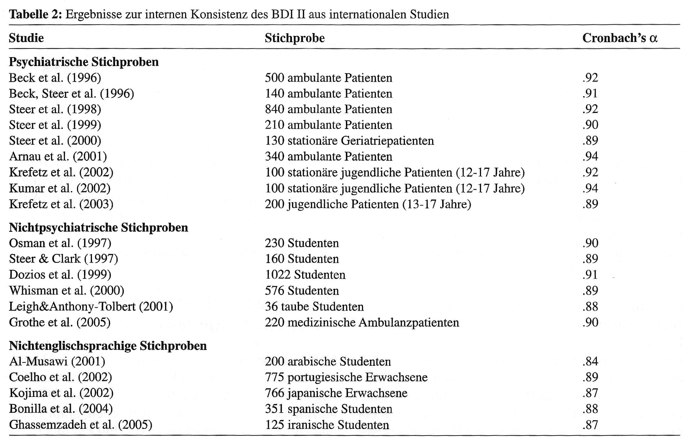

#  {.plain}
\center
```{r, echo = FALSE, out.width = "20%"}
knitr::include_graphics("3-Abbildungen/gdt-3-otto.png")
```

\vspace{2mm}

\Huge
Grundlagen der Testtheorie
\vspace{6mm}

\large
BSc Psychologie WiSe 2026/27

\normalsize
\vspace{6mm}
Prof. Dr. Dirk Ostwald

#  {.plain}

\vfill
\center
\Huge
\textcolor{red}{Aufnahme läuft!}
\vfill

#  {.plain}
```{=latex}
\vfill
\begin{center}
\huge
(3) Reliabilität und interne Konsistenz
\end{center}
\vfill
```

#
\vfill
\setstretch{1.8}
\large
Reliabilität

Interne Konsistenz

Itemanalyse

Selbstkontrollfragen
\vfill

#
\vfill
\setstretch{1.8}
\large
**Reliabilität**

Interne Konsistenz

Itemanalyse

Selbstkontrollfragen
\vfill


# Reliabilität
\small
Testgütekriterium Reliabilität

\footnotesize
\glqq Ein Test ist dann *reliabel*, wenn er das Merkmal, das er misst, exakt, d.h.
ohne Messfehler misst. Vor dem Hintergrund der Klassischen Testtheorie
unterscheidet
man die *Retest-Reliabilität*, die *Paralleltest-Reliabilität*, die
*Testhalbierungs-Reliabilität (Split-Half-Reliabilität)* und die *Innere
Konsistenz*
eines Tests.\grqq{}

\flushright @moosbrugger2012, Kapitel 2

\vspace{6mm}
\justifying
\footnotesize

\glqq Unter *Reliabilität* wird die Genauigkeit einer Messung verstanden. Ein Testverfahren
ist perfekt reliabel, wenn die damit erhaltenen Testwerte frei von zufälligen
Messfehlern sind.
Das Testverfahren ist umso weniger reliabel, je größer die Einflüsse von
zufälligen Messfehlern sind\grqq{}

\flushright @moosbrugger2012, Kapitel 6


# Reliabilität
\small
\setstretch{2.2}
Testgütekriterium Reliabilität
\footnotesize

* Die Reliabilität ist definiert als die quadrierte Korrelation von beobachtetem
  und wahrem Wert.
* Anhand der Eigenschaften des Modells multipler Testmessungen ergeben sich
  verschiedene Interpretationen.
* Die Interpretation nach @moosbrugger2012 findet sich auch.
* Messfehlerfreie Testmessungen sind allerdings sicherlich nur ein nicht zu
  erreichendes Ideal.
* Wir betrachten zunächst die Reliabilität von Testmessungen im Modell multipler
  Testmessungen.
* Allerdings ergibt sich dabei keine Möglichkeit, die Reliabilität von
  Testmessungen empirisch zu messen.
* Zentral ist dann die Definition der *Paralleltestreliabilität*. Diese ist
  empirisch messbar.
* Bei der Retest-Reliabilität handelt es sich um eine spezielle
  Paralleltestreliabilität.
* Innere Konsistenz und Split-Half-Reliabilität betrachten wir im Abschnitt
  Interne Konsistenz.


# Reliabilität
\footnotesize
\begin{definition}[Reliabilität einer Testmessung]
Gegeben sei das Modell multipler Testmessungen für eine beliebige Testmessung
$j$ mit $1 \le j \le m$,
\begin{equation}
\mbb{P}(\tau_{1j},y_{1j}, ..., \tau_{nj}, y_{nj})
:= \prod_{i=1}^n \mbb{P}(\tau_{ij},y_{ij})
:= \prod_{i=1}^n \mbb{P}(y_{ij}|\tau_{ij})\mbb{P}(\tau_{ij})
\end{equation}
wobei nach Definition des Modells gilt, dass
\begin{equation}
\mbb{P}(\tau_{1j},y_{1j}) = \cdots = \mbb{P}(\tau_{nj},y_{nj}).
\end{equation}
Die \textit{Reliabilität der Testmessung $j$} ist dann definiert als
\begin{equation}
\mbox{R}_j := \rho(y_{ij},\tau_{ij})^2 \mbox{ für ein beliebiges } 1 \le i \le n.
\end{equation}
\end{definition}

Bemerkungen

* Vor dem Hintergrund des vereinfachten Modells der Klassischen Testtheorie
  schreibt man auch $\mbox{R} = \rho(y,\tau)^2$

# Reliabilität
\footnotesize
\setstretch{2.5}

Bemerkungen (fortgesetzt)

* Die Reliabilität einer Testmessung ist als quadrierte Korrelation von
  beobachtetem und wahrem Wert definiert.
* Mit  $-1 \le \rho(y_{ij},\tau_{ij})\le 1$ folgt direkt, dass $0 \le \mbox{R}_j
  \le 1$.
* $\mbox{R}_j = 0$ impliziert $\rho(y_{ij},\tau_{ij}) = 0$, also die
  Unkorreliertheit von beobachtetem und wahrem Wert.
* $\mbox{R}_j = 0$ impliziert also, dass der beobachtete Wert hinsichtlich des
  wahren Werts nicht aussagekräftig ist
* $\mbox{R}_j= 1$ impliziert $\rho(y_{ij},\tau_{ij}) = \pm 1$, also die
  linear-affine Abhängigkeit von beobachtetem und wahrem Wert.
* $\mbox{R}_j = 1$ impliziert also, dass der beobachtete Wert hinsichtlich des
  wahren Werts aussagekräftig ist.
* Weil wahre Werte nur indirekt beobachtbar sind, wird eine alternative Form zu
  *Reliabilitätsschätzung* genutzt.

# Reliabilität
\vspace{2mm}
\footnotesize
\begin{theorem}[Eigenschaften der Reliabilität einer Testmessung]
\justifying
\normalfont
Gegeben sei das Modell multipler Testmessungen für eine beliebige Testmessung
$j$ mit $1 \le j \le m$,
\begin{equation}
\mbb{P}(\tau_{1j},y_{1j}, ..., \tau_{nj}, y_{nj})
:= \prod_{i=1}^n \mbb{P}(y_{ij}|\tau_{ij})\mbb{P}(\tau_{ij}).
\end{equation}
Dann gilt für die Reliabilität $\mbox{R}_j$ der Testmessung $j$, dass
\begin{itemize}
\item[(1)] $\mbox{R}_j = \frac{\mbb{V}(\tau_{ij})}{\mbb{V}(y_{ij})}$
\item[(2)] $\mbox{R}_j = 1 - \frac{\mbb{V}(\eps_{ij})}{\mbb{V}(y_{ij})}$
\end{itemize}
für alle $1 \le i \le n$.
\end{theorem}
\vspace{-2mm}
\underline{Beweis}

\noindent (1) Mit Aussage (5) von \href{../2-Modelle-der-klassischen-Testtheorie/2-Modelle-der-klassischen-Testtheorie.pdf}{Theorem Eigenschaften bezüglich einer Testmessung (Foliensatz 2)} gilt
\begin{equation}
\mbox{R}_j
= \rho(y_{ij},\tau_{ij})^2
= \left(\frac{\mbb{C}(y_{ij},\tau_{ij})}{\mbb{S}(y_{ij})\mbb{S}(\tau_{ij})}\right)^2
= \frac{\mbb{C}(y_{ij},\tau_{ij})^2}{\mbb{V}(y_{ij})\mbb{V}(\tau_{ij})}
= \frac{\mbb{V}(\tau_{ij})^2}{\mbb{V}(y_{ij})\mbb{V}(\tau_{ij})}
= \frac{\mbb{V}(\tau_{ij})}{\mbb{V}(y_{ij})}.
\end{equation}

\noindent (2) Mit Aussage (4) von \href{../2-Modelle-der-klassischen-Testtheorie/2-Modelle-der-klassischen-Testtheorie.pdf}{Theorem Eigenschaften bezüglich einer Testmessung (Foliensatz 2)}  gilt dann weiter
\begin{equation}
\mbox{R}_j
= \frac{\mbb{V}(\tau_{ij})}{\mbb{V}(y_{ij})}
= \frac{\mbb{V}(y_{ij})-\mbb{V}(\eps_{ij})}{\mbb{V}(y_{ij})}
= \frac{\mbb{V}(y_{ij})}{\mbb{V}(y_{ij})} - \frac{\mbb{V}(\eps_{ij})}{\mbb{V}(y_{ij})}
= 1 - \frac{\mbb{V}(\eps_{ij})}{\mbb{V}(y_{ij})}.
\end{equation}
\hfill $\Box$

# Reliabilität
\setstretch{2.5}
\footnotesize

Bemerkungen

* Da $\tau_{ij}$ und $\eps_{ij}$ nicht direkt beobachtbar sind, sind (1) und (2)
  nur von theoretischem Interesse.
* Die Reliabilität einer Testmessung ist der Anteil der Varianz des wahren Werts
  an der des beobachteten Werts,
\begin{equation}
\mbox{R}_j = \frac{\mbb{V}(\tau_{ij})}{\mbb{V}(y_{ij})} = \frac{\mbb{V}(\tau_{ij})}{\mbb{V}(\tau_{ij}) + \mbb{V}(\eps_{ij})}.
\end{equation}
* Ist $\mbb{V}(\tau_{ij}) = 0$, so ist auch $\mbox{R}_j = 0$, ist
  $\mbb{V}(\eps_{ij}) = 0$ so ist $\mbox{R}_j = 1$.
* $\mbox{R}_j > 0$ impliziert also, dass der wahre Wert eine von Null
  verschiedene Varianz (über Testpersonen) hat.
* Die Reliabilität entspricht auch 1 minus dem Anteil der Varianz des
  Messfehlers an der des beobachteten Werts.

# Reliabilität
\footnotesize
\setstretch{1.2}
\vspace{2mm}
\begin{definition}[Reliabilität einer Paralleltestmessung]
Gegeben sei das Modell paralleler Testmessungen für eine beliebige Testmessung
$j$ mit $1 \le j \le m$,
\begin{equation}
\mbb{P}(\tau_{1},y_{1j}, ..., \tau_{n},y_{nj})
:= \prod_{i=1}^n \mbb{P}(\tau_i, y_{ij})
= \prod_{i=1}^n \mbb{P}(\tau_i)\mbb{P}(y_{ij}|\tau_i)
\end{equation}
wobei nach Definition des Modells gilt, dass
\begin{equation}
\mbb{P}(\tau_{1},y_{1j}) = \cdots = \mbb{P}(\tau_{n},y_{nj}).
\end{equation}
Die \textit{Reliabilität der Paralleltestmessung $j$} ist dann definiert als
\begin{equation}
\mbox{R}_j := \rho(y_{ij},\tau_{i})^2 \mbox{ für ein beliebiges } 1 \le i \le n.
\end{equation}
\end{definition}

Bemerkungen

* In Bezug auf das vereinfachte Modell der Klassischen Testtheorie schreibt man
  auch hier $\mbox{R}=\rho(y,\tau)^2$


# Reliabilität
\footnotesize
\begin{theorem}[Paralleltestreliabilität]\label{thm:paralleltestreliabilitaet}
\justifying
\normalfont
Gegeben sei das Modell paralleler Testmessungen. Dann gelten
\begin{itemize}
\item[(1)] $\mbox{R}_j = \frac{\mbb{V}(\tau_{i})}{\mbb{V}(y_{ij})}$ für alle $1 \le j \le m$.
\item[(2)] $\mbox{R}_j = 1 - \frac{\mbb{V}(\eps_{ij})}{\mbb{V}(y_{ij})}$ für alle $1 \le j \le m$.
\item[(3)] $\mbox{R}_j = \rho(y_{ij},y_{ik}) = \mbox{R}_k$ für alle $1 \le j,k \le m$ mit $j \neq k$.
\end{itemize}
\end{theorem}
Bemerkungen

* Aussagen (1) und (2) sind analog zum Theorem der Reliabilität multipler
  Testmessungen.
* Aussage (3) des Theorems begründet die Paralleltest- und
  Retestreliabilitätsschätzung.
* Man sagt dazu vereinfachend, dass \glqq die Korrelation paralleler
  Testmessungen gleich ihrer Reliabilität ist\grqq{}.
* Zur Messung der Reliabilität nutzt man eine Schätzung der Korrelation zweier
  paralleler Testmessungen.
* Die Klassische Testtheorie begründet dieses Vorgehen durch Annahme von wahren
  Werten und Messfehlerwerten.

# Reliabilität
\footnotesize
\underline{Beweis}

\noindent (1) Mit Aussage (5) \href{../2-Modelle-der-klassischen-Testtheorie/2-Modelle-der-klassischen-Testtheorie.pdf}{Theorem Eigenschaften des Modells paralleler Testmessungen (Foliensatz 2)} gilt
\begin{equation}
\mbox{R}_j
= \rho(y_{ij},\tau_{i})^2
= \left(\frac{\mbb{C}(y_{ij},\tau_{i})}{\mbb{S}(y_{ij})\mbb{S}(\tau_{i})}\right)^2
= \frac{\mbb{C}(y_{ij},\tau_{i})^2}{\mbb{V}(y_{ij})\mbb{V}(\tau_{i})}
= \frac{\mbb{V}(\tau_{i})^2}{\mbb{V}(y_{ij})\mbb{V}(\tau_{i})}
= \frac{\mbb{V}(\tau_{i})}{\mbb{V}(y_{ij})}.
\end{equation}
\vspace{1mm}

\noindent (2) Mit Aussage (4) von \href{../2-Modelle-der-klassischen-Testtheorie/2-Modelle-der-klassischen-Testtheorie.pdf}{Theorem Eigenschaften bezüglich einer Testmessung (Foliensatz 2)} gilt
\begin{equation}
\mbox{R}_j
= \frac{\mbb{V}(\tau_{i})}{\mbb{V}(y_{ij})}
= \frac{\mbb{V}(y_{ij})-\mbb{V}(\eps_{ij})}{\mbb{V}(y_{ij})}
= \frac{\mbb{V}(y_{ij})}{\mbb{V}(y_{ij})} - \frac{\mbb{V}(\eps_{ij})}{\mbb{V}(y_{ij})}
= 1 - \frac{\mbb{V}(\eps_{ij})}{\mbb{V}(y_{ij})}.
\end{equation}
\vspace{1mm}

\noindent (3) Mit Aussagen (2) und (5) von \href{../2-Modelle-der-klassischen-Testtheorie/2-Modelle-der-klassischen-Testtheorie.pdf}{Theorem Eigenschaften des Modells paralleler Testmessungen (Foliensatz 2)} gilt
\begin{equation}
\mbox{R}_j
= \frac{\mbb{V}(\tau_{i})}{\mbb{V}(y_{ij})}
= \frac{\mbb{C}(y_{ij},y_{ik})}{\sqrt{\mbb{V}(y_{ij})}\sqrt{\mbb{V}(y_{ij})}}
= \frac{\mbb{C}(y_{ij},y_{ik})}{\sqrt{\mbb{V}(y_{ij})}\sqrt{\mbb{V}(y_{ik})}}
= \rho(y_{ij},y_{ik})
\end{equation}
und dass ebenso
\begin{equation}
\mbox{R}_k
= \frac{\mbb{V}(\tau_{i})}{\mbb{V}(y_{ik})}
= \frac{\mbb{C}(y_{ij},y_{ik})}{\sqrt{\mbb{V}(y_{ik})}\sqrt{\mbb{V}(y_{ik})}}
= \frac{\mbb{C}(y_{ij},y_{ik})}{\sqrt{\mbb{V}(y_{ij})}\sqrt{\mbb{V}(y_{ik})}}
= \rho(y_{ij},y_{ik}).
\end{equation}


# Reliabilität
\small
\vspace{2mm}
Normalverteilungsbeispiel
\setstretch{1.2}

\footnotesize
Wir betrachten den Fall zweier Testmessungen $j = 1,2$ im Modell paralleler
Testmessungen. Für  alle $i = 1,...,n$
seien in Wahrscheinlichkeitsdichteform, wobei wir der notationellen Einfachheit
halber auf das $i$ Subskript verzichten wollen,
\begin{equation}
p(t) =  N(t; 0,\sigma_\tau^2)
\mbox{ und }
p(y_1|t) :=  N(y_1; t,\sigma_\eps^2) \mbox{ und } p(y_2|t) :=  N(y_2; t,\sigma_\eps^2)
\end{equation}
Für Person $i$ gibt es also nur eine Zufallsvariable des wahren Werts für alle
Testmessungen
und die Propensitätsverteilungen unterscheiden sich zwischen Testmessungen
nicht.

Dann gilt zunächst mit dem  [\textcolor{blue}{Theorem zu gemeinsamen
Normalverteilungen}](https://www.ipsy.ovgu.de/ipsy_media/Methodenlehre+I/Sommersemester+2025/Allgemeines+Lineares+Modell/04_Normalverteilungen.pdf)
mit $A := 1$ und $b := 0$
\begin{equation}
p(t)p(y_1|t)
= p(t,y_1)
= N\left(
\begin{pmatrix} t \\ y_1 \end{pmatrix};
\begin{pmatrix} 0 \\ 0 \end{pmatrix},
\begin{pmatrix} \sigma_{\tau}^2 & \sigma_{\tau}^2  \\  \sigma_{\tau}^2  & \sigma_{\tau}^2 + \sigma_{\eps}^2  \end{pmatrix}
\right)
\end{equation}
und weiterhin mit $A := \begin{pmatrix} 1 & 0\end{pmatrix}$ und $b := 0$
\begin{equation}
p(t,y_1)p(y_2|t)
= p(t,y_1,y_2)
= N\left(
\begin{pmatrix} t  \\ y_1 \\ y_2 \end{pmatrix};
\begin{pmatrix} 0 \\ 0 \\ 0 \\ \end{pmatrix},
\begin{pmatrix}
\sigma_{\tau}^2  & \sigma_{\tau}^2                              & \sigma_{\tau}^2            \\
\sigma_{\tau}^2  & \sigma_{\tau}^2 + \sigma_{\eps}^2     & \sigma_{\tau}^2            \\
\sigma_{\tau}^2  & \sigma_{\tau}^2                              & \sigma_{\tau}^2 + \sigma_{\eps}^2
\end{pmatrix}
\right)
\end{equation}

# Reliabilität
\small
\vspace{2mm}
Normalverteilungsbeispiel (fortgeführt)
\setstretch{1.2}

\footnotesize
Damit gilt dann durch Ablesen am Kovarianzmatrixparameter von $p(t,y_1,y_2)$,
dass
\begin{equation}
\rho(y_1, y_2)
= \frac{\mbb{C}(y_1, y_2)}{\sqrt{\mbb{V}(y_1)}\sqrt{\mbb{V}(y_2)}}
= \frac{\sigma_{\tau}^2}{\sqrt{\sigma_{\tau}^2 + \sigma_{\eps}^2}\sqrt{\sigma_{\tau}^2 + \sigma_{\eps}^2}}
= \frac{\sigma_{\tau}^2}{\sigma_{\tau}^2 + \sigma_{\eps}^2}
\end{equation}
Insbesondere gilt also auch für $j = 1,2$
\begin{equation}
\mbox{R}_j
= \rho(y_j,\tau)^2
= \left(\frac{\mbb{C}(y_j,\tau)}{\mbb{S}(y_j)\mbb{S}(\tau)}\right)^2
= \frac{\mbb{C}(y_j,\tau)^2}{\mbb{V}(y_j)\mbb{V}(\tau)}
= \frac{\left(\sigma_\tau^2\right)^2}{(\sigma_{\tau}^2 + \sigma_{\eps}^2)\sigma_\tau^2}
= \frac{\sigma_\tau^2}{\sigma_{\tau}^2 + \sigma_{\eps}^2}
= \rho(y_1, y_2).
\end{equation}
Gilt also beispielsweise $\sigma_{\tau}^2 := 1.0$ und  $\sigma_{\eps}^2 := 0.2$,
so ergibt sich für die Paralleltestreliabilität
\begin{equation}
\mbox{R}_j = \rho(y_j,\tau)^2 = \rho(y_1, y_2) = \frac{1.0}{1.0 + 0.2} \approx 0.83.
\end{equation}
Man beachte, dass es sich hierbei um eine auf Grundlage der Modellparameter
bestimmte Größe,
nicht um eine basierend auf beobachteten Daten geschätzte Größe handelt.


# Reliabilität
\footnotesize
\begin{definition}[Paralleltestreliabilitätsschätzer]
Gegeben sei das Modell paralleler Testmessungen für $n$ Testpersonen und zwei
Testmessungen $j = 1,2$,
\begin{equation}
\mbb{P}(\tau_1,y_{11},y_{12},...,\tau_n,y_{n1},y_{n2}) =
\prod_{i=1}^n\mbb{P}(\tau_i)\mbb{P}(y_{i1}|\tau_i)\mbb{P}(y_{i2}|\tau_i)
\end{equation}
Dann wird der  mit den Stichprobenmitteln
\begin{equation}
\bar{y}_1 := \frac{1}{n}\sum_{i=1}^n y_{i1}
\mbox{ und }
\bar{y}_2 := \frac{1}{n}\sum_{i=1}^n y_{i2}
\end{equation}
definierte Stichprobenkorrelationskoeffizient
\begin{equation}
r_{12}:= \frac{\frac{1}{n-1}\sum_{i=1}^n(y_{i1} - \bar{y}_1)(y_{i2} - \bar{y}_2)}{\sqrt{\frac{1}{n-1}\sum_{i=1}^n (y_{i1} - \bar{y}_1)^2}\sqrt{\frac{1}{n-1}\sum_{i=1}^n (y_{i2} - \bar{y}_2)^2}}
\end{equation}
\textit{Paralleltestreliabilitätsschätzer} genannt und häufig mit $r_{tt}$ bezeichnet.
\end{definition}
Bemerkungen

* **R** bietet mit der `cor()` Funktion eine Möglichkeit,
  Stichprobenkorrelationskoeffizienten zu berechnen.

# Reliabilität
\small
Normalverteilungsbeispiel (fortgeführt)
\footnotesize

Simulation des Normalverteilungsbeispiels für $n := 30$
\vspace{3mm}

$p(t_i) =  N(t_i; 1,\sigma_\tau^2)$ und $p(y_{ij}|t_i) :=  N(y_{ij};
t_i,\sigma_\eps^2)$ für $j = 1,2$
mit $\sigma_\tau^2 := 1.0$ und $\sigma_\eps^2 := 0.2$  für  $i = 1,...,n$.

\vspace{3mm}
\tiny
```{r, echo = TRUE}
n           = 30                                    # Personenanzahl
m           = 2                                     # Testmessungsanzahl
sigsqr_tau  = 1                                     # wahrer Wert Varianz
sigsqr_eps  = .2                                    # Messfehlervarianz
R_12        = sigsqr_tau/(sigsqr_tau+sigsqr_eps)    # Paralleltestreliabilität
Tau           = matrix(rep(NaN, n)  , nrow = n)       # wahrer Wert Array
Y           = matrix(rep(NaN, n*m), nrow = n)       # beobachteter Wert Array
E           = matrix(rep(NaN, n*m), nrow = n)       # Messfehler Array
for(i in 1:n){                                      # Personeniterationen
    Tau[i]  = rnorm(1,1,sqrt(sigsqr_tau))             # wahrer Wert Realisierung für j = 1,2
    for(j in 1:m){                                  # Testmessungsiterationen
        Y[i,j]  = rnorm(1,Tau[i],sqrt(sigsqr_eps))    # beobachteter Wert Realisierung
        E[i,j]  = Y[i,j] - Tau[i]}}                   # Messfehler Realisierung
r_12      = cor(Y[,1],Y[,2])                        # Reliabilitätsschätzer
```

```{r}
cat("Paralleltestreliabilität R_12            : ", round(R_12,4),
    "\nParalleltestreliabilitätsschätzer  r_12 : ",  round(r_12,4))
```

# Reliabilität
Praxis der Paralleltestreliabilitätsschätzung

\footnotesize
Die Items einer Paralleltestform müssen gleichzeitig anders und ähnlich zum
Originaltest sein.

Je ähnlicher die Items, desto größer sollte der zeitliche Testabstand sein, um
Lerneffekte zu vermindern.

Je unähnlicher die Items, desto kürzer sollte der zeitliche Testabstand sein, um
systematische Einflüsse zu verringern.

Bei Leistungstests ist dies zum Teil möglich

* Für manche Aufmerksamkeits- und Schuleignungstests existieren Parallelformen
* Für manche Subtests von Intelligenztests existieren Parallelformen

Praktisch werden Teststichprobenmittel, -standardabweichungen, und
-korrelationen bestimmt

Ähneln sich Stichprobenmittel und  -varianzen bei hoher Korrelation, so schließt
man auf Parallelität

Bei Persönlichkeitsfragebögen oder klinischen Tests gestaltet sich dies eher
schwierig

* Meist sind diese Tests gerade durch ihre speziellen Items charakterisiert
* Es müssten große Pools ähnlicher Items existieren


\flushright @moosbrugger2012, Kapitel 6, @pospeschill2022, Kapitel 6

# Reliabilität
Praxis der Retestreliabilitätsschätzung

\footnotesize
Derselbe Test wird an derselben Stichprobe zweimal durchgeführt.

Die Korrelation der Messwerte über beide Darbietungen wird berechnet und als
$r_{tt}$ bezeichnet.

Es wird vorausgesetzt, dass die Annahmen des Modells paralleler Testmessungen
gelten.

* Der wahre Wert einer Testperson bleibt über die Testmessungen hinweg konstant
* Die bedingten Varianzen der beobachteten Werte bleiben über Testwiederholungen
  konstant

Mögliche Änderungen der wahren Werte im Zeitverlauf

* Unsystematische Veränderungen oder situative Faktoren, die über Testpersonen
  unterschiedlich
ausgeprägt sind, wie z.B. interindividuell unterschiedliche Übungseffekte,
Tagesformen,
instabile Merkmale oder Erinnerungseffekte verringern die Retestreliabilität.
Kurze
Test-Retest-Intervalle minimieren dabei unsystematische Merkmalsveränderungen,
aber maximieren Erinnerungseffekte und vice versa.
* Systematische Veränderungen oder situative Faktoren, die alle Testpersonen
gleich betreffen, ändern die Retestreliabilität nicht. Im Modell der multiplen
Testmessungen entspricht dies den hier nicht weiter vertieften wesentlich
$\tau$-äquivalenten Testmessungen.

\flushright @moosbrugger2012, Kapitel 6, @pospeschill2022, Kapitel 6


# Reliabilität
\vspace{1mm}
\small
Potentielle Dynamiken wahrer Werte von $n = 5$ Testpersonen über Testmessungen

```{r, echo = FALSE, eval = FALSE}
if(capabilities("cairo")){
  cairo_pdf(
  filename    = "3-Abbildungen/gdt-4-test-retest-dynamiken.pdf",
  width       = 8,
  height      = 8,
  family      = "sans")
} else {
  pdf(
  file        = "3-Abbildungen/gdt-4-test-retest-dynamiken.pdf",
  width       = 8,
  height      = 8,
  family      = "sans")
}
par(
family      = "sans",
mfrow       = c(2,2),
mar         = c(4,4,3,1),
pty         = "s",
bty         = "l",
lwd         = 1,
las         = 1,
mgp         = c(2,1,0),
xaxs        = "i",
yaxs        = "i",
font.main   = 1,
cex         = 1,
cex.main    = 1)
x           = 1:2
Tau         = list(
              cbind(c(1.2, 2.3, 3.4, 4.5, 5.6),
                    c(1.2, 2.3, 3.4, 4.5, 5.6)),
              cbind(c(5.4, 4.3, 3.5, 2.4, 1.3),
                    c(4.7, 5.8, 3.5, 4.1, 2.0)),
              cbind(c(1.2, 2.2, 3.2, 4.2, 5.2),
                    c(2.0, 3.0, 4.0, 5.0, 6.0)),
              cbind(c(5.0, 4.0, 3.0, 2.0, 1.0),
                    c(5.2, 4.8, 4.1, 3.7, 2.8)))
Titel       = c("A. Zeitlich stabiles Merkmal",
                "B. Zeitlich instabiles Merkmal",
                "C. Systematischer Effekt",
                "D. Unsystematischer Effekt")
for(p in 1:4){
  matplot(
  x,
  t(Tau[[p]]),
  type        = "l",
  lty         = 1,
  col         = "black",
  xaxt        = "n",
  xlab        = ifelse(p %in% c(3,4), "Zeitpunkt", ""),
  ylab        = ifelse(p %in% c(1,3), "Wahrer Wert", ""),
  xlim        = c(.8, 2.2),
  ylim        = c(.5, 6.5),
  main        = Titel[p])
  axis(1, at = x, labels = c("Test", "Retest"))
  for(i in 1:5){
    points(
    x,
    Tau[[p]][i, ],
    pch         = 21,
    col         = "white",
    bg          = "black",
    cex         = 1.1)
  }
}
dev.off()
```

```{r, echo = FALSE, out.width = "45%", fig.align = "center"}
knitr::include_graphics("3-Abbildungen/gdt-4-test-retest-dynamiken.pdf")
```

\footnotesize
\vspace{1mm}
\flushright
Nach @pospeschill2022, Kapitel 6
\vspace{1mm}

\centering
\begin{tabular}{ll}
A Identische wahre Werte bei einem stabilen Merkmal                 & $\Rightarrow$ Hohe Reliabilität             \\
B Variierende wahre Werte bei einem instabilen Merkmal              & $\Rightarrow$ Verringerung der Reliabilität \\
C Identische linear-affine Transformation des wahren Werts          & $\Rightarrow$ Hohe Reliabilität             \\
D Variable positiv linear-affine Transformation des wahren Werts    & $\Rightarrow$ Verringerung der Reliabilität \\
\end{tabular}


#
\vfill
\setstretch{1.8}
\large
Reliabilität

**Interne Konsistenz**

Itemanalyse

Selbstkontrollfragen
\vfill


# Interne Konsistenz
Motivation

\small
BDI-II Interne Konsistenz (@hautzinger2006)

\footnotesize
In Tabelle 2 sind bisherige Ergebnisse zur internen Konsistenz (Cronbach's
$\alpha$)
des BDI II aufgelistet. In psychiatrischen Stichproben lag die interne
Konsistenz
im Bereich von $0.89 \le \alpha \le 0.94$, in nichtklinischen Stichproben im
Bereich von
$0.84 \le \alpha \le 0.91$.

\vspace{1mm}

```{r, echo = FALSE,  out.width = "70%", fig.align = "center"}

```

# Interne Konsistenz
\small
\setstretch{1.2}
Vorbemerkungen
\footnotesize

$y_{ij}$ bezeichnete bisher die Zufallsvariable zur Modellierung des
beobachteten Werts
der $j$ten Testmessung der $i$ten Testperson, wobei wir $m$ Testmessungen $j =
1,...,m$
und $n$ Testpersonen $i = 1,...,n$ angenommen haben.

$\Rightarrow$ Wir haben bisher offen gelassen, ob mit der *$j$ten Testmessung*
ein *Test* oder ein *Item* gemeint ist.

$\Rightarrow$ In diesem Abschnitt identifizieren wir die $j$te Testmessung nun
mit dem $j$ten Item *eines* Tests.

$y_{ij}$ bezeichnet also nun die Zufallsvariable zur Modellierung des
beobachteten Werts
des $j$ten Items der $i$ten Testperson in einem Test, wobei wir weiterhin $m$
Items
$j = 1,...,m$ und $n$ Testpersonen $i = 1,...,n$ annehmen.

Insbesondere gehen wir davon aus, dass für jede Testperson eine Summe von
beobachteten Werten durch Summation über die Items eines Tests gebildet wird.
Die Zufallsvariable zur Modellierung dieser Summe von beobachteten Werten
bezeichnen wir mit
\begin{equation}
y_i := \sum_{j=1}^m y_{ij}
\end{equation}

Wir fassen diese Vorüberlegungen in der Definition des
*$m$-Komponententestmodells* zusammen.

# Interne Konsistenz

\footnotesize
\begin{definition}[$m$-Komponententestmodell]
\justifying
Gegeben sei das Modell multipler Testmessungen für $i = 1,...,n$ Testpersonen
und
$j = 1,...,m$ Testmessungen. Für $i = 1,...,n$ seien
\begin{itemize}
\item $y_i    := \sum_{j=1}^m y_{ij}$ die \textit{Summe der beobachteten Werte} und
\item $\tau_i := \sum_{j=1}^m \tau_{ij}$ die \textit{Summe der wahren Werte}.
\end{itemize}
Dann heißt die gemeinsame Verteilung der $y_i$ und $\tau_i$ für $i = 1,...,n$
mit der Faktorisierungseigenschaft
\begin{equation}
\mbb{P}(\tau_1,...,\tau_n,y_1,...,y_n)
:= \prod_{i=1}^n \mbb{P}(\tau_i,y_i)
= \prod_{i=1}^n \mbb{P}(y_i|\tau_i)\mbb{P}(\tau_i)
\end{equation}
\textit{das $m$-Komponententestmodell}, wenn gilt, dass
\begin{equation}
\mbb{P}(\tau_1,y_1) = \cdots = \mbb{P}(\tau_n,y_n).
\end{equation}
\end{definition}

Bemerkung

* Die $m$ *Komponenten* eines Tests entsprechen seinen $m$ Items.


# Interne Konsistenz
\footnotesize
\begin{definition}[Reliabilitäten von $m$-Komponententestmodellen]\label{def:reliabilitaeten-m-komponententestmodelle}
\justifying
Gegeben sei ein $m$-Komponententestmodell.
\vspace{2mm}

\noindent (1) Für $j = 1,...,m$ ist die Reliabilität der $j$ten Testmessung definiert als
\begin{equation}
\mbox{R}_j := \frac{\mbb{V}(\tau_{ij})}{\mbb{V}(y_{ij})} \mbox{ für ein beliebiges } 1 \le i \le n.
\end{equation}

\noindent (2) Die Gesamtreliabilität des $m$-Komponententestmodells ist definiert als
\begin{equation}
\mbox{R} := \frac{\mbb{V}(\tau_i)}{\mbb{V}(y_i)} \mbox{ für ein beliebiges } 1 \le i \le n.
\end{equation}
\end{definition}

Bemerkung

* Die Definitionen nutzen die erste Umformung der im vorherigen Abschnitt
  genutzten Definition.
* In $\mbox{R}_j$ gehen die Varianzen des $j$ten wahren Werts $\tau_{ij}$ und
  $j$ten beobachteten Werts $y_{ij}$ ein.
* In $\mbox{R}$ gehen die Varianzen der Summe $\tau_{i}$ der wahren Werte und
  der Summe $y_{i}$ der beobachteten Werte ein.
* Wenn das $m$-Komponententestmodell einen psychologischen Test bestehend aus
  $m$ Items modelliert, dann wird $R_j$ auch
*Itemreliabilität* des $j$ten Items und $\mbox{R}$ *Reliabilität des Tests*
genannt.


# Interne Konsistenz

\small
Cronbach's $\alpha$

\footnotesize
Grundlage der Bestimmung von Cronbach's $\alpha$ ist die Idee der
*Testhalbierungs-Reliabilität*

* Besteht ein Test aus vielen Items, so kann eine Testhälfte als Paralleltest
  der anderen angesehen werden.
* Die Korrelation der Testhälften ist dann ein Maß für die
  Paralleltestreliabilität.

Die resultierende Testhälften-Korrelation ist aber nur die Reliabilität eines
Tests halber Länge

Grundsätzlich erhöht sich die Reliabilität eines Tests paralleler Items mit
zunehmender Testlänge

* Die Varianz der Messfehler  erhöht sich linear, da Messfehler nach Annahme
  unabhängig sind.
* Die Varianz der wahren Werte erhöht sich quadratisch, da wahre Werte nach
  Annahme kovariieren.

Die Split-Half-Korrelation muss also auf die volle Testlänge aufgewertet werden.

* Dies ist mit der von @spearman1910 und @brown1910 entwickelten Formel möglich

Man kann einen Test natürlich auch in mehr als zwei Teile teilen und alle
Paralleltestkorrelationen bestimmen.

* Cronbach's $\alpha$ bildet die Situation ab, in der alle Items als
  Paralleltests betrachtet werden.

Wir betrachten in der Folge die Spearman-Brown Formel und ihre Eigenschaften als
Spezialfall von Cronbach's $\alpha$.


# Interne Konsistenz
\footnotesize
\begin{definition}[Cronbach's $\alpha$]
Gegeben sei ein $m$-Komponententestmodell. Dann heißt
\begin{equation}
\alpha := \frac{m}{m-1}\left(1 - \frac{\sum_{j=1}^m \mbb{V}(y_{ij})}{\mbb{V}(y_i)}\right) \mbox{ für beliebiges } 1 \le i \le n
\end{equation}
\textit{Cronbach's $\alpha$} oder \textit{Koeffizient $\alpha$}.
\end{definition}
Bemerkungen

* $\mbb{V}(y_{ij})$ ist die Varianz der beobachteten Werte für Testpersonen $i =
  1,...,n$ und Items $j = 1,...,m$.
* $\mbb{V}(y_i)$ ist die Varianz der Summe der beobachteten Werte für
  Testpersonen $i = 1,...,n$.
* Die Formel wurde durch @cronbach1951 als *Coefficient $\alpha$* popularisiert
* Frühere Anwendungen finden sich zum Beispiel in @hoyt1941 und @guttman1945

# Interne Konsistenz
\vspace{2mm}
\footnotesize
Bemerkungen (fortgesetzt)
\vspace{-1mm}

* Da nach Annahme des Modells multipler Testmessungen die Verteilungen der
  beobachteten Werte über Personen identisch sind,
wird Cronbach's $\alpha$ häufig auch geschrieben als
\begin{equation}
\alpha := \frac{m}{m-1}\left(1 - \frac{\sum_{j=1}^m \mbb{V}(y_{j})}{\mbb{V}(y)}\right)
\end{equation}
* Zum Verständnis von $\alpha$ unterstellen wir im Folgenden, dass die Anzahl
  der Items hoch, also $\frac{m}{m-1} \approx 1$ ist.
* Nach
  \href{../A-Wahrscheinlichkeitstheoretische-Ergänzungen/A-Wahrscheinlichkeitstheoretische-Ergänzungen.pdf}{Theorem
  Varianz einer Linearkombination (Foliensatz A)} gilt dann allgemein
\begin{equation}
\mbb{V}(y) = \sum_{j = 1}^m \mbb{V}(y_j) + 2 \sum_{j=1}^{m-1}\sum_{k = j+1}^m \mbb{C}(y_j,y_k)
\end{equation}
* Sind die beobachteten Werte in diesem Fall (marginal) unabhängig, so gilt
\begin{equation}
\mbb{C}(y_j,y_k) = 0 \mbox{ für alle } 1 \le j,k \le m
\end{equation}
* Bei großem $m$ und Unabhängigkeit der beobachteten Werte gilt also
\begin{equation}
\alpha
\approx 1 \cdot \left(1 - \frac{\sum_{j=1}^m \mbb{V}(y_{j})}{\mbb{V}(y)}\right)
= \left(1 - \frac{\sum_{j=1}^m \mbb{V}(y_{j})}{\sum_{j = 1}^m \mbb{V}(y_j)}\right)
= 0
\end{equation}
* Induziert ein gemeinsamer wahrer Wert andererseits marginale Kovarianzen
  $\mbb{C}(y_j,y_k) > 0$, so folgt
\begin{equation}
\mbb{V}(y)
=   \sum_{j = 1}^m \mbb{V}(y_j) + 2 \sum_{j=1}^{m-1}\sum_{k = j+1}^m \mbb{C}(y_j,y_k)
\gg \sum_{j = 1}^m \mbb{V}(y_j)
\Rightarrow
\frac{\sum_{j=1}^m \mbb{V}(y_{j})}{\mbb{V}(y)} \approx 0 \Rightarrow \alpha \approx 1
\end{equation}

# Interne Konsistenz
\footnotesize
\begin{theorem}[Cronbach's $\alpha$ und Gesamtreliabilität]\label{thm:cronbachs-alpha}
\justifying
\normalfont
Gegeben sei ein $m$-Komponententestmodell mit Gesamtreliabilität $\mbox{R}$.
Dann gilt
für Cronbach's $\alpha$, dass
\begin{equation}
\alpha \le  \mbox{R}
\end{equation}
und Gleichheit tritt insbesondere dann ein, wenn die Testmessungen des
$m$-Komponententestmodells parallel sind.
\end{theorem}

Bemerkungen

* Cronbach's $\alpha$ ist eine untere Grenze für die Gesamtreliabilität eines
  $m$-Komponententestmodells.
* Die Gesamtreliabilität eines $m$-Komponententestmodells ist mindestens so groß
  wie Cronbach's $\alpha$.
* Die Gesamtreliabilität eines $m$-Komponententestmodells kann größer als
  Cronbach's $\alpha$ sein.
* Für parallele Testmessungen (Items) ist die Gesamtreliabilität eines
  $m$-Komponententestmodells gleich $\alpha$.
* Der Beweis des Theorems geht unter anderem auf @novick1967 zurück.

# Interne Konsistenz
\footnotesize
\underline{Beweis}

Zur Vereinfachung der Notation verzichten wir auf die explizite Auszeichnung der
Testpersonen $i = 1,...,n$ und setzen
\begin{equation}
y_{j} := y_{ij},
\tau_{j} := \tau_{ij},
y := \sum_{j=1}^m y_{j}
\mbox{ und }
\tau := \sum_{j=1}^m \tau_{j},
\end{equation}
sowie
\begin{equation}
\mbox{R} := \frac{\mbb{V}(\tau)}{\mbb{V}(y)} \mbox{ und }
\alpha := \frac{m}{m-1}\left(1 - \frac{\sum_{j=1}^m \mbb{V}(y_{j})}{\mbb{V}(y)}\right).
\end{equation}
Wir gehen in vier Schritten vor.

\noindent (1) (*Summendarstellung*) Wir schreiben zunächst die Summe von $m$ Zahlen
um. Speziell gilt für reelle Zahlen $\tau_1,...,\tau_m$, dass
\begin{equation}
\sum_{j=1}^m \tau_j = \frac{1}{m-1}\sum_{j=1}^{m-1}\sum_{k = j + 1}^m (\tau_j + \tau_k).
\end{equation}

# Interne Konsistenz
\footnotesize
\underline{Beweis}

Anstelle eines Beweises betrachten wir den Fall $m := 4$. Dann gilt
\begin{align}
\begin{split}
\frac{1}{3}\sum_{j=1}^{3}\sum_{k = j + 1}^4 (\tau_j + \tau_k)
& = \frac{1}{3}\left(\sum_{k = 1 + 1}^4 (\tau_1 + \tau_k)  + \sum_{k = 2 + 1}^4
(\tau_2 + \tau_k) + \sum_{k = 3 + 1}^4 (\tau_3 + \tau_k)\right) \\
& = \frac{1}{3}\left(\sum_{k = 2}^4 (\tau_1 + \tau_k) + \sum_{k = 3}^4 (\tau_2 +
\tau_k) +\sum_{k = 4}^4 (\tau_3 + \tau_k)\right) \\
& = \frac{1}{3}\left((\tau_1 + \tau_2) + (\tau_1 + \tau_3) + (\tau_1 + \tau_4) +
(\tau_2 + \tau_3) + (\tau_2 + \tau_4) + (\tau_3 + \tau_4) \right) \\
& = \frac{1}{3}\left((\tau_1 + \tau_1 + \tau_1) + (\tau_2 + \tau_2 + \tau_2) +
(\tau_3 + \tau_3 + \tau_3) + (\tau_4 + \tau_4 + \tau_4)  \right) \\
& = \frac{1}{3}\left(3\tau_1+ 3\tau_2+ 3\tau_3 + 3\tau_4 \right) \\
& = \tau_1 + \tau_2 + \tau_3 + \tau_4   \\
& = \sum_{j = 1}^4 \tau_j      \\
\end{split}
\end{align}

# Interne Konsistenz
\footnotesize
\underline{Beweis (fortgeführt)}

\noindent (2) (*Kovarianzungleichung für den wahren Wert*) Wir leiten nun im Modell multipler
Testmessungen eine Ungleichung her. Dazu betrachten wir im Modell multipler
Testmessungen
die Varianz der Differenz zweier wahrer Werte $\tau_j$ und $\tau_k$. Mit
\href{../A-Wahrscheinlichkeitstheoretische-Ergänzungen/A-Wahrscheinlichkeitstheoretische-Ergänzungen.pdf}{Theorem
Nichtnegativität der Varianz (Foliensatz A)}
und
\href{../A-Wahrscheinlichkeitstheoretische-Ergänzungen/A-Wahrscheinlichkeitstheoretische-Ergänzungen.pdf}{Theorem
Varianzen spezieller Linearkombinationen (Foliensatz A)} ergibt sich
\begin{align}
\begin{split}
\mbb{V}(\tau_j - \tau_k)                                            \ge 0
\Leftrightarrow
\mbb{V}(\tau_j) + \mbb{V}(\tau_k) - 2\mbb{C}(\tau_j,\tau_k)   \ge 0
\Leftrightarrow
\mbb{V}(\tau_j) + \mbb{V}(\tau_k)                                \ge 2\mbb{C}(\tau_j,\tau_k)
\end{split}
\end{align}
Weiterhin ergibt sich für beliebige $1 \le j,k \le m$ parallele Testmessungen,
dass
\begin{equation}
\mbb{V}(\tau_j - \tau_k) = \mbb{V}(f_j(\tau_1) - f_k(\tau_1)) =  \mbb{V}(\tau_1 - \tau_1) = \mbb{V}(0) = 0.
\end{equation}
In diesem Fall ergibt sich in obiger Ungleichung und ihrer Anwendung im
Folgenden also Gleichheit.

\noindent(3) (*Varianzungleichung für die Summe wahrer Werte*) Wir betrachten nun die
Varianz der Summe der wahren Werte im $m$-Komponententestmodell. Mit
\href{../A-Wahrscheinlichkeitstheoretische-Ergänzungen/A-Wahrscheinlichkeitstheoretische-Ergänzungen.pdf}{Theorem Varianz einer Linearkombination (Foliensatz A)} der Summendarstellung, aus (1) und
der Kovarianzungleichung für den wahren Wert aus (2) ergibt sich zunächst

# Interne Konsistenz
\footnotesize
\underline{Beweis (fortgeführt)}
\begin{align}
\begin{split}
\mbb{V}(\tau)
& = \mbb{V}\left(\sum_{j=1}^m \tau_j\right) \\
& = \sum_{j=1}^m \mbb{V}(\tau_j) + 2\sum_{j=1}^{m-1}\sum_{k = j + 1 }^m
\mbb{C}(\tau_j, \tau_k) \\
& = \frac{1}{m-1}\sum_{j=1}^{m-1}\sum_{k = j + 1 }^m \left(\mbb{V}(\tau_j) +
\mbb{V}(\tau_k)\right) + 2\sum_{j=1}^{m-1}\sum_{k = j + 1 }^m \mbb{C}(\tau_j,
\tau_k) \\
& \ge \frac{1}{m-1}\sum_{j=1}^{m-1}\sum_{k = j + 1 }^m 2 \mbb{C}(\tau_j, \tau_k)
+ \sum_{j=1}^{m-1}\sum_{k = j + 1 }^m 2\mbb{C}(\tau_j, \tau_k) \\
& = \left(\frac{1}{m-1} + 1 \right) \sum_{j=1}^{m-1}\sum_{k = j + 1 }^m
2\mbb{C}(\tau_j, \tau_k) \\
& = \left(\frac{1}{m-1} + \frac{m-1}{m-1} \right) \sum_{j=1}^{m-1}\sum_{k = j +
1 }^m 2\mbb{C}(\tau_j, \tau_k) \\
& = \frac{1 + m - 1}{m-1} \sum_{j=1}^{m-1}\sum_{k = j + 1 }^m 2\mbb{C}(\tau_j,
\tau_k) \\
& = \frac{m}{m-1} \sum_{j=1}^{m-1}\sum_{k = j + 1 }^m 2\mbb{C}(\tau_j, \tau_k)
\\
\end{split}
\end{align}

# Interne Konsistenz
\footnotesize
\underline{Beweis (fortgeführt)}

Mit Aussage (5) von
\href{../2-Modelle-der-klassischen-Testtheorie/2-Modelle-der-klassischen-Testtheorie.pdf}{Theorem
Eigenschaften bezüglich zweier Testmessungen (Foliensatz 2)} und wiederum
mit
\href{../A-Wahrscheinlichkeitstheoretische-Ergänzungen/A-Wahrscheinlichkeitstheoretische-Ergänzungen.pdf}{Theorem
Varianz einer Linearkombination (Foliensatz A)} gilt dann
\begin{align}
\begin{split}
\mbb{V}(\tau)
& \ge \frac{m}{m-1} \sum_{j=1}^{m-1}\sum_{k = j + 1 }^m 2\mbb{C}(\tau_j, \tau_k)
\\
&  =  \frac{m}{m-1} \sum_{j=1}^{m-1}\sum_{k = j + 1 }^m 2\mbb{C}(y_j, y_k) \\
& = \frac{m}{m-1} \left(\mbb{V}\left(\sum_{j=1}^m y_j\right) - \sum_{j=1}^m
\mbb{V}\left(y_j\right) \right)\\
& = \frac{m}{m-1} \left(\mbb{V}(y) - \sum_{j=1}^m \mbb{V}\left(y_j\right)
\right)\\
\end{split}
\end{align}

# Interne Konsistenz
\footnotesize
\underline{Beweis (fortgeführt)}

\noindent (4) (*Gesamtreliabilität*) Wir betrachten schließlich die Gesamtreliabilität im $m$-Komponententestmodell. Es ergibt sich
\begin{align}
\begin{split}
\mbox{R}
& = \frac{\mbb{V}(\tau)}{\mbb{V}(y)} \\
& \ge \frac{\frac{m}{m-1} \left(\mbb{V}(y) - \sum_{j=1}^m
\mbb{V}\left(y_j\right)\right)}{\mbb{V}(y)} \\
& = \frac{m}{m-1} \left(\frac{\mbb{V}(y)}{\mbb{V}(y)} - \frac{\sum_{j=1}^m
\mbb{V}\left(y_j\right)}{\mbb{V}(y)}\right) \\
& = \frac{m}{m-1} \left(1 - \frac{\sum_{j=1}^m
\mbb{V}\left(y_j\right)}{\mbb{V}(y)}\right) \\
& =: \alpha.
\end{split}
\end{align}
$\hfill\Box$

# Interne Konsistenz
\footnotesize
\begin{definition}[Cronbach's $\alpha$ Schätzer]
\justifying
Gegeben sei das $m$-Komponententestmodell mit beobachteten Werten $y_{ij}$
für $i = 1,...,n$ Testpersonen und $j = 1,...,m$ Testkomponenten (Items). Dann
ist ein Schätzer für die Varianz des $j$ten Items gegeben durch
\begin{equation}
S^2_j := \frac{1}{n-1}\sum_{i=1}^n \left(y_{ij} - \bar{y}_j\right)^2 \mbox{ mit } \bar{y}_j := \frac{1}{n}\sum_{i=1}^n y_{ij}
\end{equation}
und ein Schätzer für die Varianz der Testsummenscores ist gegeben durch
\begin{equation}
S^2 := \frac{1}{n-1}\sum_{i=1}^n \left(y_i - \bar{y}\right)^2 \mbox{ mit }
y_i := \sum_{j=1}^m y_{ij}
\mbox{ und }
\bar{y} := \frac{1}{n}\sum_{i=1}^n y_i
\end{equation}
Ein Schätzer für $\alpha$ ergibt sich entsprechend zu
\begin{equation}
\hat{\alpha} = \frac{m}{m-1}\left(1 - \frac{\sum_{j=1}^m S^2_j}{S^2}\right).
\end{equation}
\end{definition}

Bemerkung

* Zur frequentistischen Verteilungstheorie dieses Schätzers, siehe z.B.
  @kristof1963, @feldt1965, @feldt1987, @vanzyl2000, @yuan2002.

# Interne Konsistenz
\small
Simulation im Modell paralleler Testmessungen
\begin{equation}
n := 30, m := 21
\mbox{ mit } \mbb{P}(\tau_{i}) := N(1,1), \mbb{P}(y_{ij}|\tau_{i}) := N(\tau_{i},4)
\mbox{ für } i = 1,...,n, j = 1,...,m.
\end{equation}

\footnotesize
\vspace{2mm}

\tiny
```{r, echo = TRUE, warning = F, message = F}
library(psych)                                  # R Paket zur Testanalyse
set.seed(0)                                     # Reproduzierbarkeit
n        = 30                                   # Personenanzahl
m        = 21                                   # Itemanzahl
mu       = 1                                    # Wahrer Wert Erwartungswertparameter
Tau      = matrix(rep(NaN, n),   nrow = n)      # Wahrer Wert Array
Y        = matrix(rep(NaN, n*m), nrow = n)      # Beobachteter Wert Array
for(i in 1:n){                                  # Iteration über Testpersonen
  Tau[i] = rnorm(1, mu, sqrt(1))                # Wahrer Wert Realisierung
  for(j in 1:m){                                # Iteration über Items
    Y[i,j] = rnorm(1, Tau[i], sqrt(4))}}        # Beobachteter Wert Realisierung
vsi      = var(apply(Y, 1, sum))                # Stichprobenvarianz der beobachteten Wert-Summen
siv      = sum(apply(Y, 2, var))                # Summe der Item-Stichprobenvarianzen
a        = (m/(m-1))*(1 - (siv/vsi))            # Direkte Berechnung von Cronbach's alpha
ap       = alpha(Y, warnings = F)               # Berechnung von Cronbach's alpha mit psych
```

```{r}
cat("Cronbach's alpha (manuell) : ", round(a,3),
    "\nCronbach's alpha (psych)   : ", round(ap$total$raw_alpha,3))
```


# Interne Konsistenz

\footnotesize
\begin{theorem}[McDonald's einfaktorielles essentiell kongenerisches $\omega$]\label{thm:mcdonalds-einfaktorielles-essentiell-kongenerisches-omega}
\normalfont
\justifying
Gegeben sei das essentiell kongenerische Testmodell. Dann gilt für die
Gesamtreliabilität $\mbox{R}$, dass
\begin{equation}
\mbox{R}
= \frac{\left(\sum_{j=1}^m l_j\right)^2\Phi}{\left(\sum_{j=1}^m l_j\right)^2\Phi + \sum_{j=1}^m \psi_j}
\end{equation}
und wird als \textit{McDonald's einfaktorielles kongenerisches $\omega$}
bezeichnet.
\end{theorem}

Bemerkungen

* Neben dem obigen $\omega$ gibt es auch ein hierarchisches $\omega_h$  und ein
  totales $\omega_t$
* $\omega_h$ und $\omega_t$ basieren auf hierarchischen Testmodellen, die hier
  nicht behandelt werden.
* Offenbar ist zur Berechnung von $\omega$ eine Schätzung der
  Faktorenanalysemodellparameter nötig.
* Unterschiedliche Faktorenanalysemodellparameterschätzer können zu
  unterschiedlichen $\omega$-Schätzwerten führen.

# Interne Konsistenz
\vspace{2mm}
\footnotesize
\underline{Beweis}

Zur Vereinfachung der Notation verzichten wir wie im Abschnitt Modelle
kongenerischer
Testmessungen auf die Auszeichnung der Testpersonen durch Subskripte $i =
1,...,n$.
Es gilt dann für die Gesamtreliabilität
\begin{equation}
\mbox{R}
= \frac{\mbb{V}(\tau)}{\mbb{V}(y)}
= \frac{\mbb{V}\left(\sum_{j=1}^m \tau_j\right)}{\mbb{V}\left(\sum_{j=1}^m y_j\right)}
\end{equation}
Wir betrachten zunächst die Varianz der Summe der wahren Werte. Mit der
Definition der wahren Werte im essentiell kongenerischen Testmodell und
\href{../A-Wahrscheinlichkeitstheoretische-Ergänzungen/A-Wahrscheinlichkeitstheoretische-Ergänzungen.pdf}{Theorem
Kovarianz von Linearkombinationen von Zufallsvariablen (Foliensatz A)} gilt,
dass
\begin{align}
\begin{split}
\mbb{V}\left(\sum_{j=1}^m \tau_j\right)
& = \mbb{V}\left(\sum_{j=1}^m \left( \mu_j + l_jx \right)\right) \\
& = \mbb{V}\left(\sum_{j=1}^m \mu_j + \sum_{j=1}^m l_jx \right)  \\
& = \mbb{C}\left(\sum_{j=1}^m \mu_j + \sum_{j=1}^m l_jx, \sum_{j=1}^m \mu_j +
\sum_{j=1}^m l_jx\right)  \\
& = \mbb{C}\left(\sum_{j=1}^m \mu_j + \sum_{j=1}^m l_jx, \sum_{k=1}^m \mu_k +
\sum_{k=1}^m l_kx\right)  \\
& = \mbb{C}\left(\sum_{j=1}^m l_jx, \sum_{k=1}^m l_kx\right)  \\
& = \sum_{j=1}^m \sum_{k=1}^m l_jl_k \mbb{C}(x,x)
\end{split}
\end{align}


# Interne Konsistenz

\footnotesize
\underline{Beweis(fortgeführt)}

Weiter gilt dann
\begin{align}
\begin{split}
\mbb{V}\left(\sum_{j=1}^m \tau_j\right)
& = \sum_{j=1}^m \left(\sum_{k=1}^m \left(l_jl_k \mbb{C}(x,x)\right)\right) \\
& = \sum_{j=1}^m  \left(\sum_{k=1}^m \left(l_jl_k \mbb{V}(x) \right)\right)\\
& = \sum_{j=1}^m  \left(\sum_{k=1}^m \left(l_jl_k \Phi \right)\right)\\
& = \Phi\sum_{j=1}^m \left(\sum_{k=1}^m \left(l_jl_k\right)\right)  \\
& = \Phi\sum_{j=1}^m \left(l_j \left(\sum_{k=1}^m l_k\right)\right)  \\
& = \Phi\left(\sum_{k=1}^m l_k\right)\left(\sum_{j=1}^m l_j\right)  \\
& = \left(\sum_{j=1}^m l_j\right)^2 \Phi                     \\
\end{split}
\end{align}


# Interne Konsistenz
\footnotesize
\underline{Beweis (fortgeführt)}

Weiterhin gilt für die Varianz der Summe der beobachteten Werte mit
\href{../A-Wahrscheinlichkeitstheoretische-Ergänzungen/A-Wahrscheinlichkeitstheoretische-Ergänzungen.pdf}{Theorem
Kovarianz von Linearkombinationen von Zufallsvariablen (Foliensatz A)} und
wiederholter Anwendung von
\href{../A-Wahrscheinlichkeitstheoretische-Ergänzungen/A-Wahrscheinlichkeitstheoretische-Ergänzungen.pdf}{Theorem
Kovarianz bei paarweiser Addition (Foliensatz A)}
\begin{align}
\begin{split}
\mbb{V}\left(\sum_{j=1}^m y_j\right)
& = \mbb{C}\left(\sum_{j=1}^m y_j, \sum_{j=1}^m y_j\right) \\
& = \mbb{C}\left(\sum_{j=1}^m y_j, \sum_{k=1}^m y_k\right) \\
& = \sum_{j=1}^m\sum_{k=1}^m \mbb{C}\left(y_j,y_k\right) \\
& = \sum_{j=1}^m\sum_{k=1}^m \mbb{C}\left(\tau_j + \eps_j,\tau_k + \eps_k\right)
\\
& = \sum_{j=1}^m\sum_{k=1}^m \left(\mbb{C}(\tau_j, \tau_k) + \mbb{C}(\tau_j,
\eps_k) + \mbb{C}(\eps_j,\tau_k) + \mbb{C}(\eps_j, \eps_k)\right). \\
\end{split}
\end{align}
Für die verbleibenden Kovarianzen gilt mit der Definition der wahren Werte im
essentiell kongenerischen Testmodell, wiederum unter Anwendung von
\href{../A-Wahrscheinlichkeitstheoretische-Ergänzungen/A-Wahrscheinlichkeitstheoretische-Ergänzungen.pdf}{Theorem
Kovarianz von Linearkombinationen von Zufallsvariablen (Foliensatz A)}, dass

# Interne Konsistenz
\footnotesize
\vspace{2mm}
\underline{Beweis (fortgeführt)}
\begin{equation}
\mbb{C}(\tau_j, \tau_k)
= \mbb{C}(\mu_j + l_jx, \mu_k + l_kx)
= l_jl_k \mbb{C}(x,x)
= l_jl_k \mbb{V}(x)
= l_jl_k \Phi \mbox{ für alle } j,k \mbox{ mit } 1 \le j,k \le m
\end{equation}
\begin{equation}
\mbb{C}(\tau_j, \eps_k)
= \mbb{C}(\mu_j + l_jx, \eps_k)
= l_j \mbb{C}(x, \eps_k)
= 0
\mbox{ für alle } j,k \mbox{ mit } 1 \le j,k \le m
\end{equation}
\begin{equation}
\mbb{C}(\eps_j, \tau_k)
= \mbb{C}(\eps_j, \mu_k + l_kx)
= l_k \mbb{C}(\eps_j, x)
= 0
\mbox{ für alle } j,k \mbox{ mit } 1 \le j,k \le m
\end{equation}
sowie
\begin{equation}
\mbb{C}(\eps_j, \eps_k)
= \mbb{C}(\eps_j, \eps_k)
=
\begin{cases}
0       & \mbox{für } j \neq k \\
\psi_j  & \mbox{für } j = k
\end{cases}
\end{equation}
\vspace{-1mm}
Entsprechend folgt
\vspace{-1mm}
\begin{align}
\begin{split}
\mbb{V}\left(\sum_{j=1}^m y_j\right)
& =
\sum_{j=1}^m
\sum_{k=1}^m
\left(
\mbb{C}(\tau_j, \tau_k) +
\mbb{C}(\tau_j, \eps_k) +
\mbb{C}(\eps_j,\tau_k)  +
\mbb{C}(\eps_j, \eps_k)
\right)
\\
& =
\sum_{j=1}^m
\sum_{k=1}^m
\left(
l_jl_k \Phi +
0 +
0 +
\mbb{C}(\eps_j, \eps_k)
\right)
\\
& =
\sum_{j=1}^m\sum_{k=1}^m\left(l_jl_k \Phi\right) + \sum_{j=1}^m\sum_{k=1}^m \mbb{C}(\eps_j, \eps_k) \\
& =
\left(\sum_{j=1}^ml_j\right)^2\Phi + \sum_{j=1}^m\psi_j. \\
\end{split}
\end{align}
Durch Einsetzen von Zähler und Nenner in die Definition der Gesamtreliabilität
ergibt sich schließlich
\begin{equation}
\mbox{R}
= \frac{\mbb{V}\left(\sum_{j=1}^m \tau_j\right)}{\mbb{V}\left(\sum_{j=1}^m y_j\right)}
= \frac{\left(\sum_{j=1}^m l_j\right)^2\Phi}{\left(\sum_{j=1}^m l_j\right)^2\Phi + \sum_{j=1}^m \psi_j}.
\end{equation}

# Interne Konsistenz

\small
Schätzung von $\omega$ in obigem Normalverteilungsmodell paralleler
Testmessungen
\tiny
\vspace{2mm}

```{r, echo = TRUE}
# McDonald's einfaktorielles kongenerisches Omega mit psych
library(psych)                                                  # psych
psycho  = omega(Y, nfactors = 1, plot = FALSE)                  # Einfaktorielle Omega-Berechnung mit psych
L_p     = as.numeric(psycho$schmid$sl[, 1])                     # Faktorladungsmatrixschätzer
Psi_p   = as.numeric(psycho$schmid$sl[, "u2"])                  # Fehlerkovarianzmatrixschätzer
Phi_p   = 1                                                     # psych Standardisierung
omega_f = ((sum(L_p)^2)*Phi_p)/((sum(L_p)^2)*Phi_p+ sum(Psi_p)) # Omega für \Phi := 1 und die obigen Schätzer
omega_p = psycho$omega.tot                                      # direkte Extraktion von Omega aus psych Ausgabe

# McDonald's einfaktorielles kongenerisches Omega mit lavaan
library(lavaan)                                                 # lavaan
colnames(Y) = paste0("y", 1:m)                                  # Itemnamen für lavaan
model   = paste0("y =~ ",paste(colnames(Y), collapse = " + "))  # Einfaktorielle CFA Spezifikation für lavaan
fam     = cfa(model, data = as.data.frame(Y))                   # Schätzung der CFA mit lavaan
theta_l = lavInspect(fam, what = "est")                         # Extraktion geschätzter Parameter
L_l     = theta_l$lambda                                        # Faktorladungsmatrixschätzer
Phi_l   = theta_l$psi                                           # Faktorvarianzschätzer
Psi_l   = theta_l$theta                                         # Fehlerkovarianzmatrixschätzer
omega_l = (sum(L_l)^2*Phi_l)/(sum(L_l)^2*Phi_l+sum(Psi_l))      # Omega für die obigen Schätzer
```

```{r, echo = FALSE}
cat("McDonald's einfaktorielles kongenerisches Omega (psych)  : ",  round(omega_p, 3),
  "\nMcDonald's einfaktorielles kongenerisches Omega (Formel) : ",  round(omega_f, 3),
  "\nMcDonald's einfaktorielles kongenerisches Omega (lavaan) : ", round(omega_l, 3))
```
# Interne Konsistenz
\footnotesize
\begin{theorem}[Spearman-Brown-Formel]\label{thm:spearman-brown-formel}
\normalfont
\justifying
Gegeben sei ein $m$-Komponententestmodell mit parallelen Testmessungen,
Reliabilität $\mbox{R}$ und Komponentenreliabilitäten $\mbox{R}_1, ...,
\mbox{R}_m$. Dann gilt
\begin{equation}
\mbox{R} = \frac{m\mbox{R}_1}{1 + (m-1)\mbox{R}_1}
\end{equation}
\end{theorem}

Bemerkungen

* Die Testhalbierungsreliabilität ergibt sich als der Spezialfall $m = 2$.
* Sei dazu $\mbox{R}_1$ die durch $\rho(y_{i1},y_{i2})$ gegebene
  Paralleltestreliabilität. Für die Gesamttestreliabilität ergibt sich
\begin{equation}
\mbox{R} = \frac{2\cdot \mbox{R}_1}{1 + (2 - 1)\mbox{R}_1} = \frac{2\rho(y_{i1},y_{i2})}{1 + \rho(y_{i1},y_{i2})}
\end{equation}
* Für $\mbox{R}_1 = 0.7$ ergibt sich beispielsweise
\begin{equation}
\mbox{R} = \frac{2\cdot 0.7}{1 + 0.7} \approx 0.82
\end{equation}
* In der Praxis unterscheidet man folgende Methoden zur Testhalbierung:
* Odd-Even: Eine Testhälfte besteht aus den ungerade, die andere aus den gerade
  nummerierten Items
* Zeitpartitionierung: Der Test wird in zwei Abschnitte geteilt, deren
  Bearbeitung die gleiche Zeit beansprucht.
* Itemzwillinge: Es werden Itemzwillinge konstruiert und zufällig einer der
  Testhälften zugeordnet.


# Interne Konsistenz
\footnotesize

\underline{Beweis}

Wir halten zunächst fest, dass nach \thmref{thm:cronbachs-alpha} und durch
Annahme
paralleler Testmessungen gilt, dass
\begin{equation}
\mbox{R} = \frac{m}{m-1}\left(1-\frac{\sum_{j=1}^m \mbb{V}(y_{j})}{\mbb{V}(y)}\right)
\end{equation}

\noindent (1) *(Summe der Varianzen der beobachteten Werte bei Parallelität)*
Nach
\href{../2-Modelle-der-klassischen-Testtheorie/2-Modelle-der-klassischen-Testtheorie.pdf}{Theorem
Eigenschaften des Modells paralleler Testmessungen (Foliensatz 2)} sind die
Varianzen aller
beobachteten Werte über Testmessungen bei parallelen Testmessungen identisch.
Es gilt also
\begin{equation}
\sum_{j=1}^m \mbb{V}(y_{j}) = \sum_{j=1}^m \mbb{V}(y_1) = m\mbb{V}(y_1)
\end{equation}


# Interne Konsistenz
\vspace{1mm}
\footnotesize
\underline{Beweis (fortgeführt)}

\noindent (2) *(Varianz der Summe der beobachteten Werte bei Parallelität)*

Mit
\href{../A-Wahrscheinlichkeitstheoretische-Ergänzungen/A-Wahrscheinlichkeitstheoretische-Ergänzungen.pdf}{Theorem
Varianz einer Linearkombination (Foliensatz A)} gilt
\begin{align}
\begin{split}
\mbb{V}(y)
& =                 \mbb{V}\left(\sum_{j=1}^m y_j\right) \\
& =                 \sum_{j=1}^m \mbb{V}(y_j) + 2 \sum_{j=1}^{m-1}\sum_{k=j+1}^m
\mbb{C}(y_j, y_k) \\
& \stackrel{(a)}{=} \sum_{j=1}^m \mbb{V}(y_1) + 2 \sum_{j=1}^{m-1}\sum_{k=j+1}^m
\mbb{C}(y_1, y_2) \\
& =                  m\mbb{V}(y_1) + 2 \mbb{C}(y_1, y_2)
\sum_{j=1}^{m-1}\sum_{k=j+1}^m 1 \\
& \stackrel{(b)}{=}  m\mbb{V}(y_1) + 2 \mbb{C}(y_1, y_2) \frac{m(m-1)}{2} \\
& =                  m\mbb{V}(y_1) + m(m-1)\rho(y_1,
y_2)\sqrt{\mbb{V}(y_1)}\sqrt{\mbb{V}(y_2)}  \\
& \stackrel{(c)}{=}  m\mbb{V}(y_1) + m(m-1)\rho(y_1,
y_2)\sqrt{\mbb{V}(y_1)}\sqrt{\mbb{V}(y_1)} \\
& \stackrel{(d)}{=}  m\mbb{V}(y_1) + m(m-1)\mbox{R}_1 \mbb{V}(y_1) \\
& =                  m\mbb{V}(y_1)\left(1 + (m-1)\mbox{R}_1\right) \\
\end{split}
\end{align}

# Interne Konsistenz
\vspace{1mm}
\footnotesize
\underline{Beweis (fortgeführt)}

Dabei gilt

* $\stackrel{(a)}{=}$ mit Aussage (5) von
  \href{../2-Modelle-der-klassischen-Testtheorie/2-Modelle-der-klassischen-Testtheorie.pdf}{Theorem
  Eigenschaften des Modells paralleler Testmessungen (Foliensatz 2)}, dass
\begin{equation}
\mbb{C}(y_j, y_k) = \mbb{V}(\tau) \mbox{ für alle } j,k \mbox{ mit } 1 \le j,k \le m
\end{equation}
also, dass die Kovarianzen der beobachteten Werte beliebiger Paare paralleler
Testmessungen identisch und damit insbesondere identisch zu $\mbb{C}(y_1, y_2)$
sind,
* $\stackrel{(b)}{=}$ mit der unter (4) per Induktionsbeweis gezeigten Identität
\begin{equation}
\sum_{j=1}^{m-1}\sum_{k=j+1}^m 1 = \frac{m(m-1)}{2}
\end{equation}
* $\stackrel{(c)}{=}$  mit Aussage (2) von
  \href{../2-Modelle-der-klassischen-Testtheorie/2-Modelle-der-klassischen-Testtheorie.pdf}{Theorem
  Eigenschaften des Modells paralleler Testmessungen (Foliensatz 2)},
* $\stackrel{(d)}{=}$  mit Aussage (3) von
  \thmref{thm:paralleltestreliabilitaet}

# Interne Konsistenz
\footnotesize
\underline{Beweis (fortgeführt)}

\noindent (3) *(Einsetzen in Cronbach's $\alpha$)*

Einsetzen ergibt dann
\begin{align}
\begin{split}
\mbox{R}
& = \frac{m}{m-1}\left(1-\frac{\sum_{j=1}^m \mbb{V}(y_{j})}{\mbb{V}(y)}\right)
\\
& = \frac{m}{m-1}\left(1-\frac{m\mbb{V}(y_1)}{m\mbb{V}(y_1)\left(1 +
(m-1)\mbox{R}_1\right)}\right) \\
& = \frac{m}{m-1}\left(1-\frac{1}{1 + (m-1)\mbox{R}_1}\right) \\
& = \frac{m}{m-1}\left(\frac{1 + (m-1)\mbox{R}_1}{1 +
(m-1)\mbox{R}_1}-\frac{1}{1 + (m-1)\mbox{R}_1}\right) \\
& = \frac{m}{m-1}\left(\frac{1 + (m-1)\mbox{R}_1-1}{1 + (m-1)\mbox{R}_1}\right)
\\
& = \frac{m}{m-1} \cdot \frac{(m-1)\mbox{R}_1}{1 + (m-1)\mbox{R}_1} \\
& = \frac{m\mbox{R}_1}{1 + (m-1)\mbox{R}_1}. \\
\end{split}
\end{align}


# Interne Konsistenz
\footnotesize
\underline{Beweis (fortgeführt)}

\noindent (4) *(Induktionsbeweis der Doppelsummenform)*

Es bleibt zu zeigen, dass
\begin{equation}
S_m := \sum_{j=1}^{m-1}\sum_{k=j+1}^m 1 = \frac{m(m-1)}{2} =: P_m
\end{equation}
(1) Induktionsanfang: Für $m := 2$ gilt
\begin{equation}
S_2
= \sum_{j=1}^{2-1}\sum_{k=j+1}^2 1
= \sum_{j=1}^1 \sum_{k=j+1}^2 1
= \sum_{k=1+1}^2 1
= \sum_{k=2}^2 1
= 1
= \frac{2(2-1)}{2}
= P_2
\end{equation}
Zu Demonstrationszwecken betrachten wir auch $m := 3$. Hier gilt
\begin{equation}
S_3
= \sum_{j=1}^{3-1}\sum_{k=j+1}^3 1
= \sum_{j=1}^2 \sum_{k=j+1}^3 1
= \sum_{k=1+1}^3 1 +  \sum_{k=2+1}^3 1
= \sum_{k=2}^3 1 +  \sum_{k=3}^3 1
= 3
= \frac{3(3-1)}{2}
= P_3
\end{equation}

\noindent (2) Induktionsschritt: Es gelte nun für ein $m \ge 2$
\begin{equation}
S_m = \sum_{j=1}^{m-1}\sum_{k=j+1}^m 1 = \frac{m(m-1)}{2} = P_m
\end{equation}


# Interne Konsistenz
\footnotesize
\underline{Beweis (fortgeführt)}

Dann gilt nach Definition für $m + 1$
\begin{align}
\begin{split}
S_{m+1}
& =  \sum_{j=1}^{m+1-1}\sum_{k=j+1}^{m+1} 1 \\
& =  \sum_{j=1}^{m}\sum_{k=j+1}^{m+1} 1     \\
& =  \sum_{j=1}^{m-1}\sum_{k=j+1}^{m+1} 1 + \sum_{k=m+1}^{m+1} 1    \\
& =  \left(\sum_{j=1}^{m-1}\sum_{k=j+1}^{m+1} 1\right) + 1   \\
& =  \left(\sum_{j=1}^{m-1}\left(\sum_{k=j+1}^{m} 1  + 1 \right) \right) + 1
\\
& =  \left(\sum_{j=1}^{m-1} \sum_{k=j+1}^{m} 1 \right) + \left(\sum_{j=1}^{m-1}
1\right) + 1   \\
& =  \left(\sum_{j=1}^{m-1} \sum_{k=j+1}^{m} 1 \right) + (m-1) + 1   \\
& =   S_m  + m   \\
\end{split}
\end{align}


# Interne Konsistenz
\footnotesize
\underline{Beweis (fortgeführt)}

Dann aber gilt nach der Induktionsschrittannahme
\begin{align}
\begin{split}
S_{m+1}
& =  S_m  + m   \\
& =  P_m  + m   \\
& = \frac{m(m-1)}{2}  + m   \\
& = \frac{m(m-1)}{2}  + \frac{2m}{2}  \\
& = \frac{m(m-1) + 2m}{2}   \\
& = \frac{m^2 - m  + 2m}{2}   \\
& = \frac{m^2 + m}{2}   \\
& = \frac{m(m+1)}{2}   \\
& = \frac{(m+1)((m+1)-1)}{2}   \\
& = P_{m+1}
\end{split}
\end{align}


# Interne Konsistenz
\small
Normalverteilungsbeispiel

\footnotesize
Wir betrachten den Fall eines $m$-Komponententestmodells mit $m$ parallelen
Testmessungen. Für alle $i = 1,...,n$ seien in Wahrscheinlichkeitsdichteform,
wobei wir wiederum auf das Subskript $i$ verzichten wollen
\begin{equation}
p(t_1) := N(t_1;1,\sigma_\tau^2), t_2 := t_1,...,t_m := t_1
\end{equation}
sowie
\begin{equation}
p(y_1|t_1) := N(y_1;t_1,\sigma_\eps^2), ...,
p(y_m|t_1) := N(y_m;t_1,\sigma_\eps^2)
\end{equation}

Per definition gilt im $m$-Komponententest mit parallelen Testmessungen für die
Gesamtreliabilität
\begin{equation}
\mbox{R}
:= \frac{\mbb{V}(\tau)}{\mbb{V}(y)}
= \frac{\mbb{V}\left(\sum_{j=1}^m \tau_j\right)}{\mbb{V}\left(\sum_{j=1}^m y_j \right)}
\end{equation}
Für den Zähler halten wir fest, dass mit der Identität der wahren Werte im
Modell paralleler Testmessungen gilt
\begin{equation}
\mbb{V}\left(\sum_{j=1}^m \tau_j\right)
= \mbb{V}\left(\sum_{j=1}^m \tau_1\right)
= \mbb{V}\left(m\tau_1\right)
= m^2\mbb{V}\left(\tau_1\right)
= m^2\sigma_\tau^2
\end{equation}

# Interne Konsistenz
\small
Normalverteilungsbeispiel (fortgeführt)

\footnotesize
Für den Nenner betrachten wir die Wahrscheinlichkeitsdichtefunktion der
gemeinsamen
Verteilung von $\tau_1, y_1,...,y_m$, die in Generalisierung des im Abschnitt
Reliabilität
betrachteten Normalverteilungsbeispiels die folgende Form hat:

\begin{equation}
p\left(t_1,y_1,...,y_m\right)
=
N\left(
\begin{pmatrix}
t_1     \\
y_1     \\
\vdots  \\
y_m
\end{pmatrix};
\begin{pmatrix}
1       \\
1       \\
\vdots  \\
1
\end{pmatrix},
\begin{pmatrix}
\sigma_\tau^2 &  \sigma_\tau^2                        & \cdots & \sigma_\tau^2                        \\
\sigma_\tau^2 &  \sigma_\tau^2 + \sigma_\eps^2 & \cdots & \sigma_\tau^2                        \\
\vdots        &  \vdots                               & \ddots & \vdots                               \\
\sigma_\tau^2 &  \sigma_\tau^2                        & \cdots & \sigma_\tau^2 + \sigma_\eps^2 \\
\end{pmatrix}
\right)
\end{equation}

Um nun die Varianz der Summe der beobachteten Werte zu bestimmen, bestimmen wir
mithilfe des
[\textcolor{blue}{Theorem zur linear-affinen Transformation eines
normalverteilten
Zufallsvektors}](https://www.ipsy.ovgu.de/ipsy_media/Methodenlehre+I/Sommersemester+2025/Allgemeines+Lineares+Modell/04_Normalverteilungen.pdf)
die Kovarianzmatrix
des durch die Matrix $A := \begin{pmatrix} 0 & 1 & ... & 1\end{pmatrix} \in
\mbb{R}^{1\times(m+1)}$
transformierten Zufallsvektors $(\tau_1,y_1,...,y_m)^T$, also die
Kovarianzmatrix von
\begin{equation}
\sum_{j=1}^m y_j
=
\begin{pmatrix} 0 & 1 & ... & 1 \end{pmatrix}
\begin{pmatrix}
\tau_1  \\
y_1     \\
\vdots  \\
y_m
\end{pmatrix}
\end{equation}

# Interne Konsistenz
\small
\vspace{2mm}
Normalverteilungsbeispiel (fortgeführt)

\footnotesize
Es ergibt sich
\begin{align*}
\begin{split}
\begin{pmatrix} 0 & 1 & ... & 1 \end{pmatrix}
\begin{pmatrix}
\sigma_\tau^2 &  \sigma_\tau^2                        & \cdots & \sigma_\tau^2                        \\
\sigma_\tau^2 &  \sigma_\tau^2 + \sigma_\eps^2 & \cdots & \sigma_\tau^2                        \\
\vdots        &  \vdots                               & \ddots & \vdots                               \\
\sigma_\tau^2 &  \sigma_\tau^2                        & \cdots & \sigma_\tau^2 + \sigma_\eps^2 \\
\end{pmatrix}
\begin{pmatrix} 0 \\ 1 \\ \vdots \\ 1 \end{pmatrix}
& =
\begin{pmatrix}
m\sigma_\tau^2
& m\sigma_\tau^2 + \sigma_\eps^2
& ...
& m\sigma_\tau^2 + \sigma_\eps^2
\end{pmatrix}
\begin{pmatrix} 0 \\ 1 \\ \vdots \\ 1 \end{pmatrix}
\\
& = m\left(m\sigma_\tau^2 + \sigma_\eps^2 \right)
\\
& = m^2\sigma_\tau^2 + m\sigma_\eps^2
\end{split}
\end{align*}
Für die Gesamtreliabilität ergibt sich folglich
\begin{equation}
\mbox{R}
= \frac{\mbb{V}(\tau)}{\mbb{V}(y)}
= \frac{\mbb{V}\left(\sum_{j=1}^m \tau_j\right)}{\mbb{V}\left(\sum_{j=1}^m y_j \right)}
= \frac{m^2 \sigma_\tau^2}{m^2\sigma_\tau^2 + m\sigma_\eps^2}
\end{equation}
Gilt also beispielsweise $\sigma^2_\tau := 1.0$ und $\sigma_\eps^2 := 0.2$,
so ergibt sich für $\mbox{R}$ bei $m := 21$ parallelen Testmessungen
\begin{equation}
\mbox{R}
= \frac{(21)^2 \cdot 1.0}{(21)^2\cdot 1.0 + 21\cdot 0.2}
= \frac{441}{441 + 4.2}
= 0.990566
\end{equation}
Basierend auf der im Abschnitt Reliabilität bestimmten Itemreliabilität
$\mbox{R}_1 = \frac{1.0}{1.2}$ ergibt sich mithilfe der
Spearman-Brown-Formel dasselbe Ergebnis
\begin{equation}
\mbox{R} = \frac{m\mbox{R}_1}{1 + (m-1)\mbox{R}_1} = \frac{21\cdot \frac{1.0}{1.2}}{1 + 20 \cdot \frac{1.0}{1.2}} = 0.990566.
\end{equation}

# Interne Konsistenz
\small
Normalverteilungsbeispiel
\vspace{2mm}
\tiny
```{r, echo = TRUE}
n           = 1e1                                                       # Anzahl Testpersonen
m           = 21                                                        # Anzahl Testmessungen
k           = 2                                                         # Anzahl Testwiederholungen
sigsqr_tau  = 1                                                         # Varianz der wahren Werte
sigsqr_eps  = 0.2                                                       # Varianz der Messfehler
R_1         = sigsqr_tau/(sigsqr_tau + sigsqr_eps)                      # Itemreliabilität
R           = ((m^2)*sigsqr_tau)/(((m^2)*sigsqr_tau + m*sigsqr_eps))    # Gesamtreliabilität nach Beispiel
SBF         = (m*R_1)/(1 + (m-1)*R_1)                                   # Gesamtreliabilität nach SB-Formel
Tau           = matrix(rep(NaN,n)  , nrow = n)                            # Initialisierung wahre Werte
Y           = array(NaN, dim = c(n, m, k))                              # Initialisierung beobachtete Werte
for(i in 1:n){                                                          # Iteration über Testpersonen
    Tau[i] = rnorm(1,1,sqrt(sigsqr_tau))                                  # Realisierung wahrer Werte pro Testperson
    for(t in 1:k){                                                      # Iteration über parallele Testwiederholungen
        for(j in 1:m){                                                  # Iteration über parallele Testmessungen
            Y[i,j,t] = rnorm(1,Tau[i], sqrt(sigsqr_eps))}}}               # Realisierung beobachteter Werte
R_tt        = cor(apply(Y, c(1, 3), sum))[1,2]                          # Korrelation der Summenscores
```

```{r}
cat("Itemreliabilität                                  : ", R_1,
    "\nGesamtreliabilität nach Normalverteilungsbeispiel : ", R,
    "\nGesamtreliabilität nach Spearman-Brown-Formel     : ", SBF,
    "\nKorrelation der Summenscores über Paralleltests   : ", R_tt)
```


#
\vfill
\setstretch{1.8}
\large
Reliabilität

Interne Konsistenz

**Itemanalyse**

Selbstkontrollfragen
\vfill


# Itemanalyse
\footnotesize
\begin{definition}[Vereinfachtes $m$-Komponententestmodell]
Gegeben sei das vereinfachte Modell multipler Testmessungen für $j = 1,...m$.
Dann heißt die gemeinsame Verteilung der $y_j$ und $\tau_j$ mit der
Faktorisierungseigenschaft
\begin{equation}
\mbb{P}(\tau_1,...,\tau_m,y_1,...,y_m)
= \mbb{P}(\tau_1,...,\tau_m)\prod_{j=1}^m \mbb{P}(y_j|\tau_j)
\end{equation}
das \textit{vereinfachte $m$-Komponententestmodell} und die beobachteten Werte
$y_1,...,y_m$ der Testmessungen die \textit{Items} des
$m$-Komponententestmodells.
Weiterhin bezeichnen wir mit
\begin{itemize}
\item $y = \sum_{j=1}^m y_j$ den \textit{Summenscore} und
\item $\tau = \sum_{j=1}^m \tau_j$ die \textit{Summe der wahren Werte}
\end{itemize}
\end{definition}

Bemerkung

* Im vereinfachten $m$-Komponententestmodell wird die Testperson $i$ nicht
  ausgzeichnet.

# Itemanalyse
\footnotesize
\begin{definition}[Itemkennwerte]
Gegeben sei das vereinfachte $m$-Komponententestmodell und eine Zufallsvariable
$u$.
Dann heißen
\begin{itemize}
\item $\mbb{E}(y_j)$ die \textit{Schwierigkeit} des $j$-ten Items,
\item $\mbb{V}(y_j)$ die \textit{Varianz} des $j$-ten Items,
\item $\mbb{S}(y_j)$ die \textit{Standardabweichung} des $j$-ten Items,
\item $\rho(y_j, y_k)$ die \textit{Korrelation} zwischen dem $j$-ten und $k$-ten Item,
\item $\rho(y_j, y)$ die \textit{Trennschärfe} des $j$-ten Items
\item $\mbox{R}_j := \rho(\tau_j, y_j)^2$ die \textit{Reliabilität} des $j$-ten Items
\end{itemize}
\end{definition}

Bemerkung

* Es handelt sich im Wesentlichen um die üblichen Definitionen von Kennwerten
  von Zufallsvariablen.

# Itemanalyse
\footnotesize
\begin{theorem}[Erwartungswert und Varianz eines Summenscores]\label{thm:erwartungswert-und-varianz-eines-summenscores}
\justifying
\normalfont
Gegeben sei das vereinfachte $m$-Komponententestmodell. Dann gelten
\begin{itemize}
\item[(1)] $\mbb{E}(y) = \sum_{j=1}^m \mbb{E}(y_j)$
\item[(2)] $\mbb{V}(y) = \sum_{j=1}^m \mbb{V}(y_j) + 2\sum_{j=1}^{m-1}\sum_{k=j+1}^m \rho(y_j, y_k)\mbb{S}(y_j)\mbb{S}(y_k)$
\end{itemize}
\end{theorem}
\underline{Beweis}

Die Aussage (1) ergibt sich unmittelbar aus
\href{../A-Wahrscheinlichkeitstheoretische-Ergänzungen/A-Wahrscheinlichkeitstheoretische-Ergänzungen.pdf}{Theorem
Erwartungswert bei linear-affiner Kombination (Foliensatz A)}
Für die Aussage (2) gilt mit
\href{../A-Wahrscheinlichkeitstheoretische-Ergänzungen/A-Wahrscheinlichkeitstheoretische-Ergänzungen.pdf}{Theorem
Varianz einer Linearkombination (Foliensatz A)}, dass
\begin{equation}
\mbb{V}(y) = \sum_{j=1}^m \mbb{V}(y_j) + 2\sum_{j=1}^{m-1}\sum_{k=j+1}^m \mbb{C}(y_j, y_k)
\end{equation}
Die Definition der Korrelation liefert dann die gewünschte Aussage, da
\begin{equation}
\rho(y_j, y_k) = \frac{\mbb{C}(y_j, y_k)}{\mbb{S}(y_j)\mbb{S}(y_k)}
\Leftrightarrow
\mbb{C}(y_j, y_k) = \rho(y_j, y_k)\mbb{S}(y_j)\mbb{S}(y_k)
\end{equation}
$\hfill\Box$

# Itemanalyse
\footnotesize
\begingroup
\setbeamerfont{block title}{size=\small}
\begin{theorem}[Spearman-Brown-Formel in mittlerer Inter-Item-Korrelationsform]\label{thm:spearman-brown-formel-mittlere-inter-item-korrelation}
\justifying
\normalfont
Gegeben sei das vereinfachte $m$-Komponententestmodell mit parallelen Items
und Inter-Item-Korrelationen $\rho(y_j, y_k) = \rho$ für alle $j,k$ mit
$1 \le j,k \le m$ und $j \neq k$. Sei weiterhin
\begin{equation}
\bar{\rho}
:= \frac{1}{m^2 - m}\sum_{j=1}^{m}\sum_{\substack{k = 1 \\ k \neq j}}^m \rho(y_j, y_k)
 = \frac{2}{m^2 - m}\sum_{j=1}^{m-1}\sum_{k=j+1}^m \rho(y_j, y_k)
\end{equation}
die mittlere Inter-Item-Korrelation. Dann gilt
\begin{equation}
\mbox{R} = \frac{m\bar{\rho}}{1 + (m-1)\bar{\rho}}
\end{equation}
\end{theorem}
\endgroup

Bemerkungen

* Es handelt sich um Gleichung (1) in @smith2000.
* $\bar{\rho}$ berechnet die mittlere Inter-Item-Korrelation nur über Itempaare
  mit $j \neq k$.

# Itemanalyse
\footnotesize
\underline{Beweis}

Wir halten zunächst fest, dass durch Vernachlässigung des Personenindex $i$
mit \thmref{thm:paralleltestreliabilitaet} für die Reliabilität des $j$-ten
Items gilt, dass
\begin{equation}
\mbox{R}_j = \rho(y_j,y_k) = \mbox{R}_k \mbox{ für alle } j,k \mbox{ mit } 1 \le j,k \le m \mbox{ und } j \neq k
\end{equation}
also insbesondere auch
\begin{equation}
\rho(y_j, y_k) = \mbox{R}_1 \mbox{ für alle } j,k \mbox{ mit } 1 \le j,k \le m \mbox{ und } j \neq k
\end{equation}
Die mittlere Inter-Item-Korrelation ergibt sich dann zu
\begin{equation}
\bar{\rho}
= \frac{1}{m^2 - m}\sum_{j=1}^{m}\sum_{\substack{k = 1 \\ k \neq j}}^m \rho(y_j, y_k)
= \frac{1}{m^2 - m}\sum_{j=1}^{m}\sum_{\substack{k = 1 \\ k \neq j}}^m \mbox{R}_1
= \frac{1}{m^2 - m} \cdot (m^2 - m)\mbox{R}_1
= \mbox{R}_1
\end{equation}
Aus der Spearman-Brown-Formel für parallele Testmessungen ergibt sich dann
unmittelbar die gewünschte Aussage, da mit \thmref{thm:spearman-brown-formel}
für parallele Testmessungen gilt, dass
\begin{equation}
\mbox{R} = \frac{m\mbox{R}_1}{1 + (m-1)\mbox{R}_1} = \frac{m\bar{\rho}}{1 + (m-1)\bar{\rho}}.
\end{equation}
$\hfill\Box$

# Itemanalyse
\setstretch{1}
\footnotesize
\begin{theorem}[Vollversions-Kurzversions-Korrelation]\label{thm:vollversions-kurzversions-korrelation}
\normalfont
\justifying
Seien
\begin{equation}
I_{\mrm{v}} := \{1,\dots,m\}, I_{\mrm{k}} \subset I_{\mrm{v}}, 0 < |I_{\mrm{k}}| < |I_{\mrm{v}}|
\end{equation}
die Itemindexmengen einer \textit{Vollversion} und einer \textit{Kurzversion}
eines vereinfachten $m$-Komponententestmodells. Die Mengen beobachteter Werte
separater Realisierungen der Vollversion und der Kurzversion seien definiert als
\begin{equation}
Y_{\mrm{v}} := \{y_{\mrm{v}j} \mid j \in I_{\mrm{v}}\}, Y_{\mrm{k}} := \{y_{\mrm{k}j} \mid j \in I_{\mrm{k}}\}.
\end{equation}
Die zugehörigen Summenscores seien definiert als
\begin{equation}
y_{\mrm{v}} := \sum_{j \in I_{\mrm{v}}} y_{\mrm{v}j}, y_{\mrm{k}} := \sum_{j \in I_{\mrm{k}}} y_{\mrm{k}j}.
\end{equation}
Die zugehörigen Mengen wahrer Werte seien definiert als
\begin{equation}
T_{\mrm{v}} := \{\tau_{\mrm{v}j} \mid j \in I_{\mrm{v}}\}, T_{\mrm{k}} := \{\tau_{\mrm{k}j} \mid j \in I_{\mrm{k}}\}.
\end{equation}
Für die Summen der wahren Werte gelte
\begin{equation}
\tau_{\mrm{v}} := \sum_{j \in I_{\mrm{v}}} \tau_{\mrm{v}j}, \tau_{\mrm{k}} := \sum_{j \in I_{\mrm{k}}} \tau_{\mrm{k}j}, \rho(\tau_{\mrm{v}}, \tau_{\mrm{k}}) = 1.
\end{equation}
Die Summenfehlerwerte der Vollversion und der Kurzversion seien definiert als
\begin{equation}
\eps_{\mrm{v}} := y_{\mrm{v}} - \tau_{\mrm{v}}, \eps_{\mrm{k}} := y_{\mrm{k}} - \tau_{\mrm{k}}.
\end{equation}
Weiterhin gelte bei separaten Realisierungen der Vollversion und der Kurzversion
\begin{equation}
\mbb{C}(\tau_{\mrm{v}},\eps_{\mrm{k}}) = 0, \mbb{C}(\tau_{\mrm{k}},\eps_{\mrm{v}}) = 0, \mbb{C}(\eps_{\mrm{v}},\eps_{\mrm{k}}) = 0.
\end{equation}
Die Reliabilitäten der Vollversion und der Kurzversion seien mit
$\mbox{R}_{\mrm{v}}$ bzw. $\mbox{R}_{\mrm{k}}$ bezeichnet. Dann gilt
\begin{equation}
\rho(y_{\mrm{v}}, y_{\mrm{k}})
= \sqrt{\mbox{R}_{\mrm{k}}\mbox{R}_{\mrm{v}}}.
\end{equation}
\end{theorem}

# Itemanalyse
\footnotesize
\underline{Beweis}

Mit den Annahmen des Theorems,
\href{../A-Wahrscheinlichkeitstheoretische-Ergänzungen/A-Wahrscheinlichkeitstheoretische-Ergänzungen.pdf}{Theorem
Kovarianz bei paarweiser Addition (Foliensatz A)},
\href{../A-Wahrscheinlichkeitstheoretische-Ergänzungen/A-Wahrscheinlichkeitstheoretische-Ergänzungen.pdf}{Theorem Symmetrie der Kovarianz (Foliensatz A)} und \defref{def:reliabilitaeten-m-komponententestmodelle}
gilt, dass
\begin{align}
\begin{split}
\rho(y_{\mrm{v}}, y_{\mrm{k}})
& = \frac{\mbb{C}(y_{\mrm{v}},
y_{\mrm{k}})}{\mbb{S}(y_{\mrm{v}})\mbb{S}(y_{\mrm{k}})} \\
& = \frac{\mbb{C}(\tau_{\mrm{v}} + \eps_{\mrm{v}}, \tau_{\mrm{k}} +
\eps_{\mrm{k}})}{\mbb{S}(y_{\mrm{v}})\mbb{S}(y_{\mrm{k}})} \\
& = \frac{\mbb{C}(\tau_{\mrm{v}}, \tau_{\mrm{k}}) +
          \mbb{C}(\tau_{\mrm{v}}, \eps_{\mrm{k}}) +
          \mbb{C}(\eps_{\mrm{v}}, \tau_{\mrm{k}}) +
          \mbb{C}(\eps_{\mrm{v}}, \eps_{\mrm{k}})}{\mbb{S}(y_{\mrm{v}})\mbb{S}(y_{\mrm{k}})} \\
& = \frac{\mbb{C}(\tau_{\mrm{v}},
\tau_{\mrm{k}})}{\mbb{S}(y_{\mrm{v}})\mbb{S}(y_{\mrm{k}})} \\
& = \frac{\mbb{C}(\tau_{\mrm{v}},
\tau_{\mrm{k}})}{\mbb{S}(y_{\mrm{v}})\mbb{S}(y_{\mrm{k}})} \cdot
    \frac{\mbb{S}(\tau_{\mrm{v}})\mbb{S}(\tau_{\mrm{k}})}{\mbb{S}(\tau_{\mrm{v}})\mbb{S}(\tau_{\mrm{k}})} \\
& = \frac{\mbb{C}(\tau_{\mrm{v}},
\tau_{\mrm{k}})}{\mbb{S}(\tau_{\mrm{v}})\mbb{S}(\tau_{\mrm{k}})} \cdot
    \frac{\mbb{S}(\tau_{\mrm{v}})}{\mbb{S}(y_{\mrm{v}})} \cdot
    \frac{\mbb{S}(\tau_{\mrm{k}})}{\mbb{S}(y_{\mrm{k}})} \\
& = \rho(\tau_{\mrm{v}}, \tau_{\mrm{k}}) \cdot
    \sqrt{\frac{\mbb{V}(\tau_{\mrm{v}})}{\mbb{V}(y_{\mrm{v}})}} \cdot
    \sqrt{\frac{\mbb{V}(\tau_{\mrm{k}})}{\mbb{V}(y_{\mrm{k}})}} \\
& = 1 \cdot \sqrt{\mbox{R}_{\mrm{v}}} \sqrt{\mbox{R}_{\mrm{k}}}\\
& = \sqrt{\mbox{R}_{\mrm{v}}\mbox{R}_{\mrm{k}}}
\end{split}
\end{align}

$\hfill\Box$

#
\vfill
\setstretch{1.8}
\large
Reliabilität

Interne Konsistenz

Itemanalyse

**Selbstkontrollfragen**
\vfill

# Selbstkontrollfragen {.allowframebreaks}
\footnotesize

1. Geben Sie die Definition der Reliabilität einer Testmessung wieder.
1. Geben Sie das Theorem zu den Eigenschaften der Reliabilität einer Testmessung
   wieder.
1. Erläutern Sie die drei äquivalenten Formen der Reliabilität einer Testmessung
   im Modell multipler Testmessungen.
1. Geben Sie die Definition der Reliabilität einer Paralleltestmessung wieder.
1. Geben Sie das Theorem zur Paralleltestreliabilität wieder.
1. Warum ist die Annahme paralleler Testmessungen für die empirische Messung der
   Reliabilität zentral?
1. Geben Sie die Definition des Paralleltestreliabilitätsschätzers wieder.
1. Erläutern Sie das praktische Vorgehen zur Durchführung einer
   Paralleltestreliabilitätsschätzung.
1. Erläutern Sie das praktische Vorgehen zur Durchführung einer
   Retestreliabilitätsschätzung.
1. Diskutieren Sie mögliche Probleme der Validität einer
   Retestreliabilitätsschätzung.
1. Geben Sie die Definition eines $m$-Komponententestmodells wieder.
1. Erläutern Sie die Gemeinsamkeiten des Modells multipler Testmessungen und des
   $m$-Komponententestmodells.
1. Erläutern Sie die Unterschiede des Modells multipler Testmessungen und des
   $m$-Komponententestmodells.
1. Geben Sie die Definition der Reliabilitäten von $m$-Komponententestmodellen
   wieder.
1. Skizzieren Sie den intuitiven Zusammenhang zwischen einer
   Testhalbierungsreliabilität und Cronbach's $\alpha$.
1. Geben Sie die Definition von Cronbach's $\alpha$ wieder.
1. Erläutern Sie die Intuition zu Cronbach's $\alpha$ basierend auf dem Theorem
   zur Varianz einer Linearkombination.
1. Geben Sie das Theorem zu Cronbach's $\alpha$ und der Gesamtreliabilität eines
   $m$-Komponententestmodells wieder.
1. Wann ist die Gesamtreliabilität eines $m$-Komponententestmodells mit
   Cronbach's $\alpha$ identisch?
1. Geben Sie die Definition des Cronbach's $\alpha$ Schätzers wieder.
1. Geben Sie das Theorem zur Spearman-Brown-Formel wieder.
1. Erläutern Sie die Spearman-Brown-Formel mit Bezugnahme auf die
   Testhalbierungsreliabilität.


# Referenzen {.allowframebreaks}
\footnotesize
